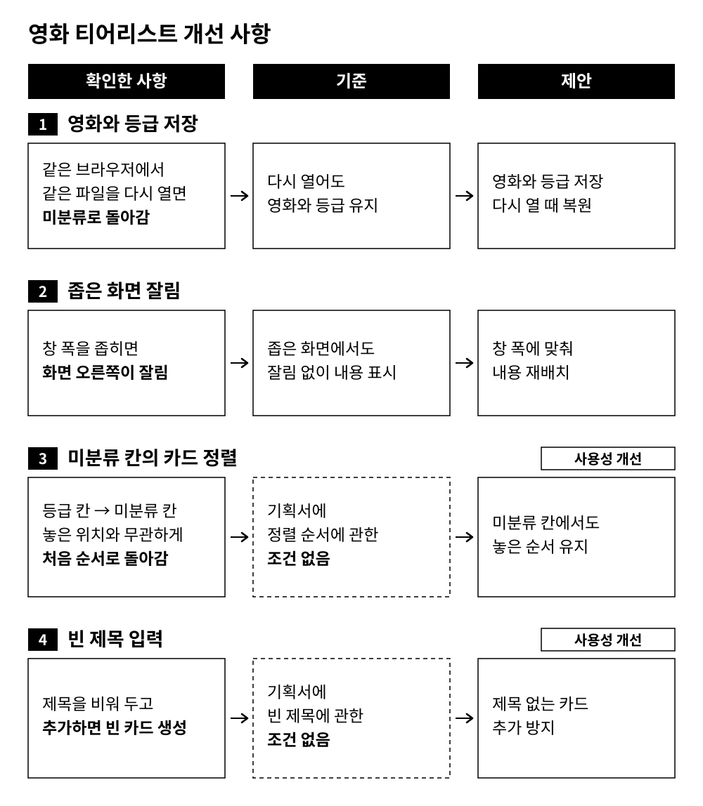

# 피드백

## 잘된 점

- 영화 추가와 등급 이동이 정상적으로 작동해 기획서의 기본적인 분류 기능을 사용할 수 있었습니다.
- 등급마다 색이 달라 칸을 구분하기 쉬웠습니다.
- 분류한 영화 수가 표시돼 얼마나 남았는지 알 수 있어 좋았습니다.
- 카드를 끌어 놓을 때 칸 색이 바뀌어 도착 위치를 확인하기 용이했습니다.

## 고치면 좋을 점

| 항목 | 확인한 사항 | 기준 | 제안 |
|---|---|---|---|
| 영화와 등급 저장 | 같은 브라우저에서 같은 파일을 다시 열면 미분류로 돌아감 | 영화와 등급 유지 | 저장 후 다시 열 때 복원 |
| 좁은 화면 잘림 | 폭을 좁히면 오른쪽이 잘림 | 좁은 화면에서도 내용 표시 | 창 폭에 맞춰 재배치 |
| 카드 정렬 | ‘아직 안 정한 영화’로 되돌리면 놓은 위치와 무관하게 처음 순서로 복귀 | 기획서에 정렬 순서에 관한 조건 없음 | 미분류 칸에서도 놓은 순서 유지(사용성 개선) |

## 질문 사항 (확인하고 싶은 점)

‘처음으로’를 누르자 추가한 영화는 사라지고 최초 8편만 남았습니다. 기획서에서 ‘처음 영화 목록과 배치로 돌아간다’는 설명과 모순되지는 않지만, 추가한 영화의 삭제 여부는 기획서에 명시되어 있지 않습니다.

**추가한 영화까지 삭제하는 것이 의도한 초기화 범위인가요?**

감사합니다.
