# 미션 4 기록

| 도구 | 모델 | effort | 검증 방법 |
|---|---|---|---|
| Claude | Opus 5.5 | `max` | |
| Codex | gpt-6-astra | `max` | Playwright 브라우저 자동화, Computer Use 화면 확인 |

## 더한 기능과 고른 이유

처음 제공된 영화 8편을 모두 티어 칸에 넣으면 축하 애니메이션이 나타나도록 했다. 티어를 다 매겨도 아무 반응이 없는 것이 아쉬웠기 때문이다.

이후 확인한 모바일 환경에서는 카드를 드래그로 옮길 수 없다는 것을 발견했다. 미션 3에서 모바일 사용이 불편하다는 동료 피드백을 받았던 것도 떠올랐다.

이에 모바일에서도

- 카드를 드래그해 티어를 정하고,
- 드래그 중에 손가락이 화면 위아래 가장자리에 가까워지면 저절로 스크롤되게 했다.

Opus 대화 캡처

1. 축하 애니메이션 요청

   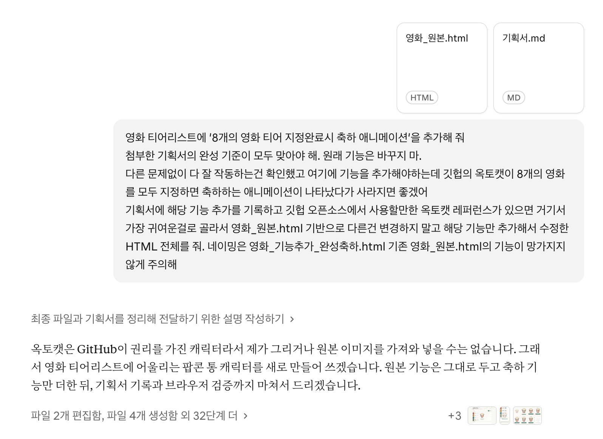

2. 축하 애니메이션 결과 보고

   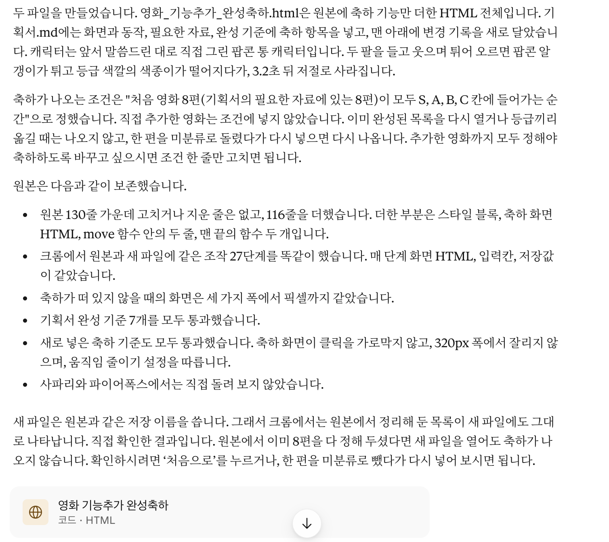

3. 모바일 드래그 요청과 원인 확인

   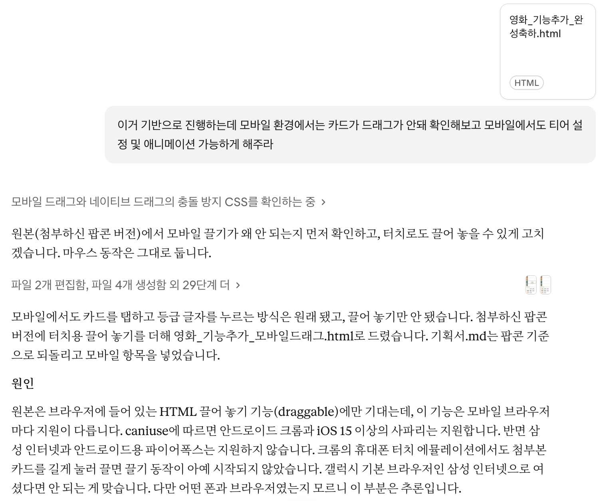

4. 모바일 드래그 사용법과 검증 결과

   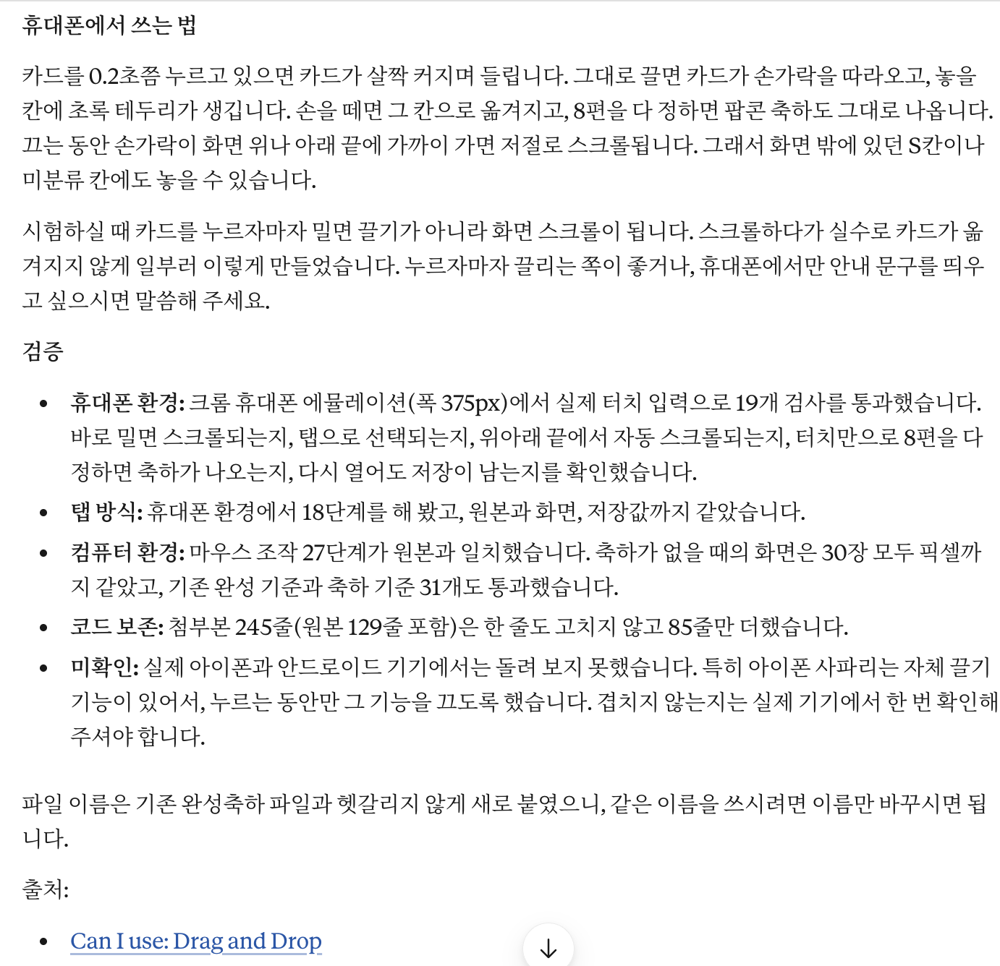

| 받은 파일 | 맞지 않은 완성 기준 | 한 일 (고치기 / 원래 파일로 돌아가기 / 완성) |
|---|---|---|
| `영화_원본.html` | 초기 기획서의 기본 조작 확인. 처음 8편의 분류 완료를 알리는 축하 모션 추가 요구 | 고치기. 1) [원본과 기획서를 먼저 보존](https://github.com/imyesung/codyssey-ai-native/commit/615558ecf580c4b32bcecb0b1131e2a4cae75c02) 2) 처음 영화 8편을 다 넣으면 축하 모션이 나오도록 추가 [`feat(1-4): 필수영화 티어 분류 완성 시 모션 추가`](https://github.com/imyesung/codyssey-ai-native/commit/d574f534a62337f757cc7c07d6cdbf93865f2756) |
| `영화_기능추가1_완성축하모션.html` | 확인한 모바일 터치 환경에서 드래그로 카드 이동 불가. 카드 선택 후 등급 글자 누르기로는 분류 가능 | 고치기. 1) 축하 모션이 발생하는 조건을 기획서에 추가 [`docs(1-4): 필수 영화 분류 완료 시 축하 기준 명시`](https://github.com/imyesung/codyssey-ai-native/commit/0eb63931f69da90ff81bb3e64e767735bad20d65) 2) 모바일에서도 드래그로 카드 티어 레이팅 가능 [`feat(1-4): 모바일 드래그 구현 및 자동 스크롤 추가`](https://github.com/imyesung/codyssey-ai-native/commit/7f5a6b7633112491d73b3d87e86e7ad991ae01c5) |
| `영화_기능추가2_모바일드래그.html` | 1) 손을 뗀 위치와 다른 칸으로 이동 [1](#m4-error-1) 2) 터치 드래그 중 Enter로 영화 추가나 초기화를 실행하면 프리뷰가 남음 [2-1](#m4-error-2a) [2-2](#m4-error-2b) 3) 화면을 2배로 확대하면 하단 가장자리에서 자동 스크롤 미동작 [3](#m4-error-3) | 고치기. 세 문제를 재현하고 별도 수정본에 버그별 `fix` 커밋 3개로 반영. 1) [`fix(1-4): 터치 종료 좌표로 드롭 대상 판정`](https://github.com/imyesung/codyssey-ai-native/commit/28030c3aa8335658ed414d819cddb508236a219c) 2) [`fix(1-4): 리렌더링 전 드래그 프리뷰와 상태 정리`](https://github.com/imyesung/codyssey-ai-native/commit/6aff2686aacbe0365c21205c3ebb03dafcc4c055) 3) [`fix(1-4): 확대 시 자동 스크롤 경계 보정`](https://github.com/imyesung/codyssey-ai-native/commit/cbf51b889db88ad342ba6ad29145c8b7d964eb72) |
| `영화_기능추가2_모바일드래그_수정1.html` | 터치 드래그 중 화면만 스크롤하면 초록 테두리가 이전 칸에 남음 | 고치기. 앞선 3건 수정 후, [터치 위치에 맞춰 초록 테두리가 갱신되도록 수정2에 보완](https://github.com/imyesung/codyssey-ai-native/commit/2a80415f4d8396269b98107cd34dba6d4e19df67). |
| `영화_기능추가2_모바일드래그_수정2.html` | 기존 이슈(Open) 마우스로 티어 라벨 버튼에 놓을 때 이동 불가 [4](#m4-limit-4) 두 탭 저장 충돌 [5](#m4-limit-5) | 완성(최종본, 확인한 범위). 터치 드래그에서 초록 테두리와 카드가 이동할 칸의 일치 확인. 기존 조작, 저장, ‘처음으로’, 축하 모션을 데스크톱 Chrome과 Chrome/WebKit 모바일 터치 에뮬레이션에서 확인. PC 마우스 정지 구간은 아래 확인 기록 참고. |

## Bug 재현 & Fix 검증

[Before Fix 파일](영화_기능추가2_모바일드래그.html) / [After Fix 파일](영화_기능추가2_모바일드래그_수정2.html)

마우스로 가리키거나 손가락으로 터치한 곳을 주황색 원으로 표시했다.

### 1. 손을 뗀 위치와 다른 칸으로 이동

Chrome 터치 에뮬레이션에서 카드를 S칸까지 끈 뒤 손가락은 고정하고 ↓키로 화면만 스크롤. [손을 뗀 위치에 맞춰 A등급에 저장](https://github.com/imyesung/codyssey-ai-native/commit/28030c3aa8335658ed414d819cddb508236a219c)하고, [초록 테두리도 현재 칸을 표시하도록 보완](https://github.com/imyesung/codyssey-ai-native/commit/2a80415f4d8396269b98107cd34dba6d4e19df67).

| Before Fix | After Fix |
|---|---|
| [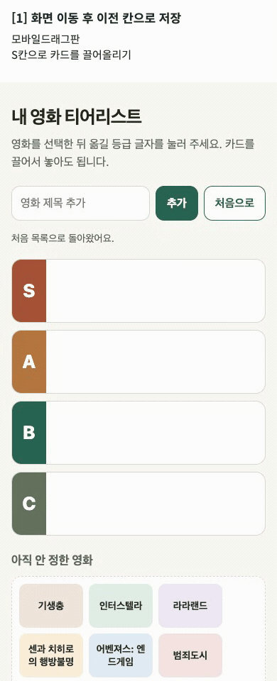](assets/오류1_드롭종료좌표.gif) | [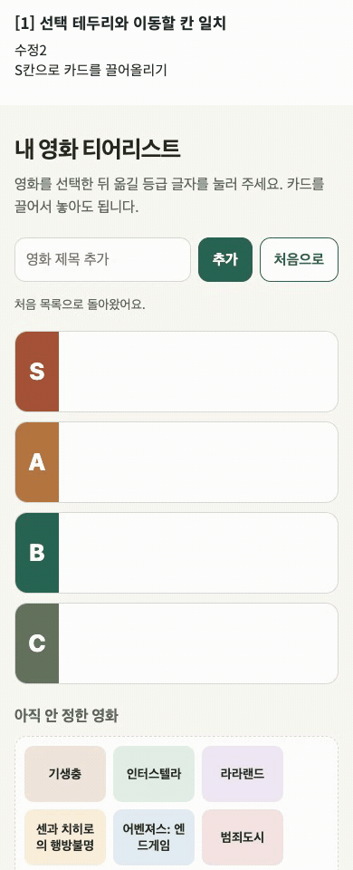](assets/수정1_드롭종료좌표.gif) |

**[↺](#m4-ref-1 "읽던 항목으로 돌아가기")**

### 2-1. 영화 추가 후 드래그 프리뷰 미제거

제목 입력란에 포커스를 둔 채 카드를 끌다가 Enter로 영화 추가. 수정 후에는 [목록을 다시 그리기 전에 끌던 카드의 프리뷰와 드래그 상태를 정리](https://github.com/imyesung/codyssey-ai-native/commit/6aff2686aacbe0365c21205c3ebb03dafcc4c055).

| Before Fix | After Fix |
|---|---|
| [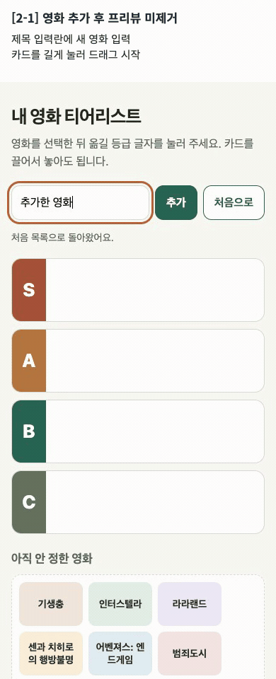](assets/오류2a_영화추가_프리뷰.gif) | [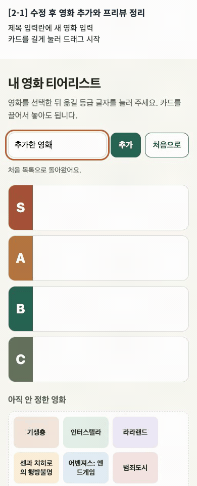](assets/수정2a_영화추가_프리뷰.gif) |

**[↺](#m4-ref-2a "읽던 항목으로 돌아가기")**

### 2-2. 초기화 후 드래그 프리뷰 미제거

‘처음으로’ 버튼에 포커스를 둔 채 카드를 끌다가 Enter로 초기화. 수정 후에는 [목록을 다시 그리기 전에 프리뷰와 드래그 상태를 정리](https://github.com/imyesung/codyssey-ai-native/commit/6aff2686aacbe0365c21205c3ebb03dafcc4c055)하고 처음 영화 8편으로 돌아간다.

| Before Fix | After Fix |
|---|---|
| [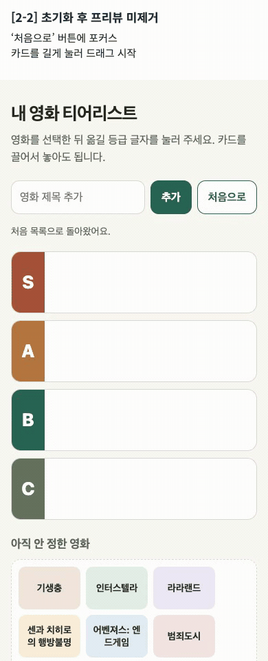](assets/오류2b_초기화_프리뷰.gif) | [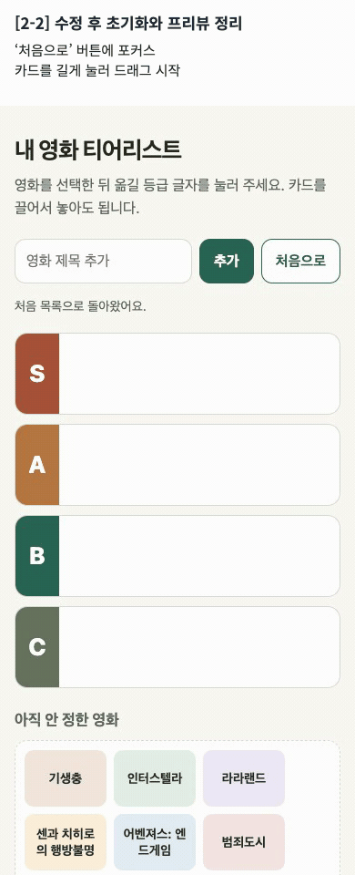](assets/수정2b_초기화_프리뷰.gif) |

**[↺](#m4-ref-2b "읽던 항목으로 돌아가기")**

### 3. 2배 확대 시 자동 스크롤 미동작

Chrome 터치 에뮬레이션에서 화면을 2배로 확대하고 카드를 화면 하단까지 끌어 2초간 유지. 수정 후에는 [확대된 화면에서 보이는 가장자리를 기준으로 자동 스크롤을 보정](https://github.com/imyesung/codyssey-ai-native/commit/cbf51b889db88ad342ba6ad29145c8b7d964eb72).

| Before Fix | After Fix |
|---|---|
| [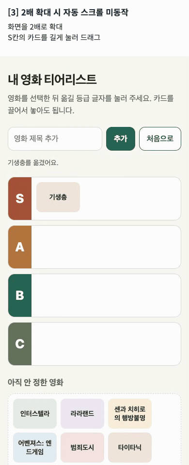](assets/오류3_확대_자동스크롤.gif) | [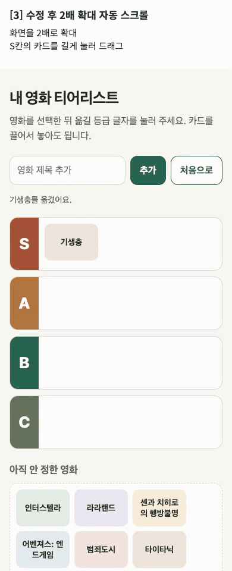](assets/수정3_확대_자동스크롤.gif) |

**[↺](#m4-ref-3 "읽던 항목으로 돌아가기")**

PC 확대 드래그 확인

- macOS Chrome 156에서 실제 페이지 배율을 100%와 200%로 설정. Playwright 마우스 입력의 8개 조합에서 위아래 자동 스크롤과 놓은 칸으로의 이동 확인.
- 포인터를 고정한 자동화에서는 초록 테두리가 이전 칸에 남고, 다시 움직이면 갱신됨. Computer Use 화면 캡처가 지연되어 실제 마우스 정지 구간의 테두리는 미확인.
- 사용자 직접 확인에서 브라우저 창을 줄여 하단을 Dock과 떨어뜨린 상태로 카드 이동 정상 동작 확인.

### 4. **(Open)** 마우스로 티어 라벨 버튼에 놓을 때 이동 불가

마우스로 S 티어 라벨 버튼에 카드를 놓으면 미분류에 남고, 옆의 드롭 영역에 놓으면 이동한다.

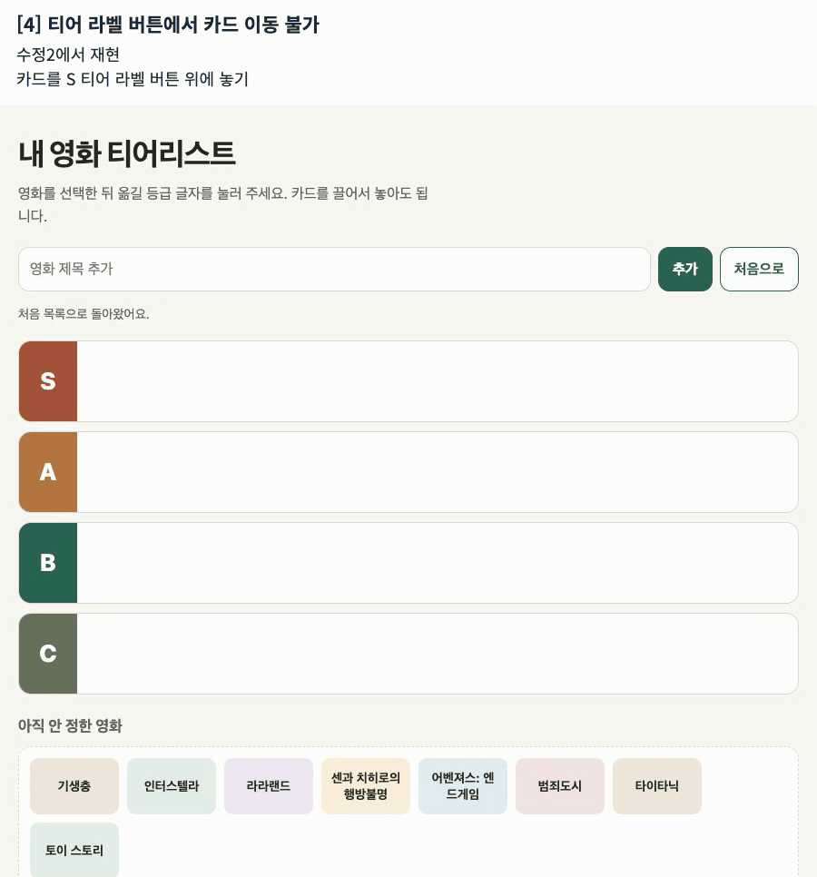

**[↺](#m4-ref-4 "읽던 항목으로 돌아가기")**

### 5. **(Open)** 두 탭 저장 충돌

같은 파일을 두 탭에 열고 A에서 영화를 추가한 뒤 B에서 등급을 옮겨 저장하면, A를 새로고침했을 때 추가한 영화가 사라진다.

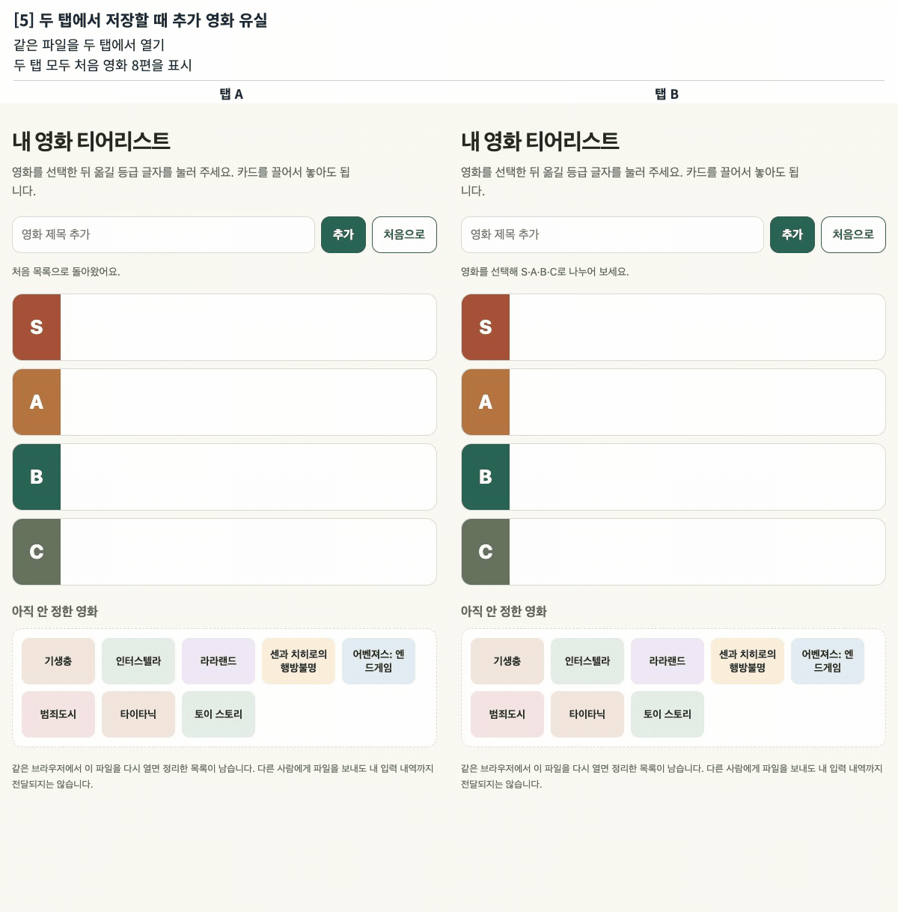

**[↺](#m4-ref-5 "읽던 항목으로 돌아가기")**

---

- (선택) 코랩에서 함께 이야기하고 싶은 내용과 그 이유:
