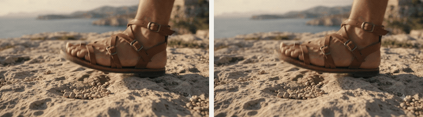
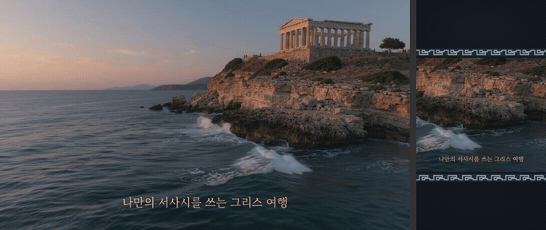

# ΕΠΟΣ

[**Cut 01 버전 비교 바로가기**](#cut-01-버전-비교) | [Cut Breakdown](#cut-breakdown)

**상영본** (16:9, 슬레이트와 크레딧 포함)　[WebM](assets/EPOS_PICTURELOCK_SCREENING_CREDITS.webm) | [원본 MP4](bonus/EPOS_PICTURELOCK_SCREENING_CREDITS.mp4)

<video controls playsinline preload="metadata" width="720" poster="./assets/preview.jpg" title="ΕΠΟΣ 상영본: 슬레이트와 크레딧 포함">
  <source src="./assets/EPOS_PICTURELOCK_SCREENING_CREDITS.webm" type='video/webm; codecs="vp8, vorbis"'>
  <source src="./assets/EPOS_PICTURELOCK_SCREENING_CREDITS_vscode.mp4" type="video/mp4">
  <a href="./assets/EPOS_PICTURELOCK_SCREENING_CREDITS.webm">상영본 WebM 열기</a>
</video>

**세로본** (9:16, 광고 본편 10초)　[WebM](assets/EPOS_PICTURELOCK_VERTICAL.webm) | [원본 MP4](bonus/ΕΠΟΣ_세로.mp4)

<video controls playsinline preload="metadata" width="320" title="ΕΠΟΣ 세로본">
  <source src="./assets/EPOS_PICTURELOCK_VERTICAL.webm" type='video/webm; codecs="vp8, vorbis"'>
  <source src="./assets/EPOS_PICTURELOCK_VERTICAL_vscode.mp4" type="video/mp4">
  <a href="./assets/EPOS_PICTURELOCK_VERTICAL.webm">세로본 WebM 열기</a>
</video>

## 서비스 정체성

**ΕΠΟΣ**(에포스)는 그리스 신화에 등장하는 이야기를 따라 실제 유적을 여행하는 코스를 추천하는 웹서비스다.

- **대상:** 신화와 유적에 관심은 있지만 어디부터 가야 할지 모르는 여행자
- **추천 기준:** 명소의 인지도보다 이야기와 유적이 이어지는 동선
- **캠페인 목표:** 광고를 본 사람이 “에포스는 그리스 신화 속 유적을 따라 걷는 여행 코스를 추천한다”고 설명할 수 있게 한다.
- **핵심 문구:** 나만의 서사시를 쓰는 그리스 여행.
- **화면 연출:** 신화를 판타지 장면으로 재현하기보다 여행자가 볼 만한 풍경을 실사풍으로 담았다. 돌을 딛는 샌들과 청동상의 손을 가까이서 보여 주고, 마지막에는 수니온의 신전과 바다를 한 화면에 담는다.
- **소리와 자막:** 남성 목소리가 그리스어로 말하면 노란 명조체 한글 자막이 뜻을 전한다. 마지막에는 “에포스”라는 발음과 낮은 북 한 번에 맞춰 바다 위에 ΕΠΟΣ가 뜬다.

## 결과물

| 용도 | 파일 | 규격 |
|---|---|---|
| 광고 본편 | [ΕΠΟΣ_광고.mp4](ΕΠΟΣ_광고.mp4) | 1280×720, 10.000초, 24fps, 240프레임 |
| 스토리보드 | [ΕΠΟΣ_스토리보드.pdf](ΕΠΟΣ_스토리보드.pdf) | 서비스 정체성, 컷별 10개 항목, 수정 기록 |
| 세로본 | [ΕΠΟΣ_세로.mp4](bonus/ΕΠΟΣ_세로.mp4) | 720×1280, 10.000초, 24fps, 240프레임 |
| 별도 상영본 | [슬레이트와 크레딧 포함](bonus/EPOS_PICTURELOCK_SCREENING_CREDITS.mp4) | 1280×720, 12.042초, 289프레임 |

## 제작 파이프라인

아래는 제작 기록을 바탕으로 소재가 다음 단계에 어떻게 쓰였는지 정리한 작업 흐름이다.

### 01 기획

- 서비스의 한 줄 소개와 캠페인 목표를 정했다.
- 10초를 여섯 컷으로 나누고, 컷마다 장소와 동작을 정해 생성 입력에 반영했다.

### 02 소재 생성

- Gemini에서 첫발 v1과 v2를 생성했다. [V02](#v02)에는 [V01](#v01)에 없던 양발의 이탈과 바위턱 사이로 물이 보이는 간격을 지정했다.
- [V03](#v03)으로 토리코스, 델포이, 미케네가 순서대로 들어간 영상 소스를 생성했다.
- 수니온의 [영어 요청](#v05)에서 오류를 기록한 뒤, [짧은 한국어 요청](#v04)으로 영상 소스를 확보했다. 어떤 변경이 성공에 영향을 줬는지는 확인하지 못했다.
- ChatGPT에서 [청동상 원화](#i01)를 생성했다. 기존 [올리브 원화](#i02)는 로고 질감에 쓸 명암 소재로 남겼다.
- Pocket TTS Greek에서 남성 내레이션 테이크를 생성해 사운드 편집용으로 넘겼다.

### 03 편집

- 첫발 v1과 v2를 비교하고, v2에서 착지와 체중 이동이 보이는 구간을 채택했다. 요청한 도약은 확인되지 않아 본편에 넣지 않았다.
- 유적 영상에서 세 장소를 각각 잘라 토리코스, 델포이, 미케네 순으로 배치했다.
- 청동상 원화 한 장에서 창을 쥔 손으로 시작해 얼굴로 올라가도록 화면을 재구성했다.
- 발, 사자 부조, 신전과 포말이 세로 화면 안에 남도록 컷별 프레이밍을 조정했다.
- 가로와 세로에서 같은 시점인 `00:06.958`에 로고를 얹고, 올리브 원화의 명암을 로고 질감에 사용했다.

### 04 사운드

- 그리스어 테이크에서 본편에 쓸 구절과 마지막 브랜드 발화를 골라 배치했다.
- Suno의 기악곡을 깔고 내레이션과의 음량 균형을 맞췄다.
- 북은 합성해 추가하고, 파도는 Gemini 영상의 동반음과 합성층을 섞었다.
- 2초대에 배치했던 합성 날갯짓 소리는 최종 믹스에서 뺐다.

### 05 마스터 검수

- 16:9와 9:16의 10초 본편을 각각 출력하고, 슬레이트와 크레딧을 넣은 상영본을 별도로 출력했다.
- 세 영상의 해상도, 길이, 프레임 수와 AAC 오디오를 확인했다.
- README의 상영본과 세로본에서 소리와 화면을 확인하고 원본 MP4 링크를 대조했다.


## Cut Breakdown

타임코드는 슬레이트가 없는 **10초 광고 본편** 기준이며, 각 구간의 끝 시각은 포함하지 않는다.

| 컷과 화면 | 본편 타임코드 | 생성 도구 | 입력 프롬프트 |
|---|---|---|---|
| **Cut&nbsp;01**<br>첫발 | `00:00.000` ~ `00:00.875` | Gemini 영상 | [V02](#v02) |
| **Cut&nbsp;02**<br>토리코스 극장 | `00:00.875` ~ `00:02.458` | Gemini 영상 | [V03](#v03) |
| **Cut&nbsp;03**<br>델포이 유적 | `00:02.458` ~ `00:03.708` | Gemini 영상, Pocket TTS Greek | [V03](#v03), [A01](#a01) |
| **Cut&nbsp;04**<br>미케네 사자의 문 | `00:03.708` ~ `00:04.250` | Gemini 영상, Pocket TTS Greek | [V03](#v03), [A01](#a01) |
| **Cut&nbsp;05**<br>청동상 | `00:04.250` ~ `00:05.667` | ChatGPT 이미지 생성, Pocket TTS Greek | [I01](#i01), [A01](#a01), [A02](#a02) |
| **Cut&nbsp;06**<br>수니온 곶 | `00:05.667` ~ `00:10.000` | Gemini 영상, RealVisXL, Pocket TTS Greek | [V04](#v04), [I02](#i02), [A02](#a02), [A03](#a03) |

### 컷별 편집

- **Cut 01** 샌들이 돌을 밀어내는 동작만 남겼다. 세로본은 발을 따라 구도를 왼쪽으로 옮겼다.
- **Cut 02** 돌 객석이 낮은 사선으로 뻗어 있는 구간을 골랐다. 세로본의 지명은 화면 중앙에 놓았다.
- **Cut 03** 객석에서 산기슭의 석주와 돌길로 넘어간다. `00:03.333`부터 그리스어 내레이션이 들린다.
- **Cut 04** 세로본에서는 사각 출입구 위의 사자 부조가 가운데 오게 했다. `00:04.250`에 돌문에서 청동상의 손으로 컷을 넘긴다.
- **Cut 05** 원화 한 장에서 창을 쥔 손과 얼굴을 차례로 보여 준다. 얼굴에 이르면 `00:05.667`에 수니온의 바다로 넘어간다.
- **Cut 06** 세로본은 `00:05.750` ~ `00:06.375`에 위아래로 화면을 넓힌다. `00:06.958`에 “에포스”라는 목소리, 북소리, 로고가 함께 들어온다. 올리브 원화의 명암을 입힌 로고는 `00:10.000`까지 남는다.

## Version Comparison

### Cut 01 버전 비교

왼쪽은 **v1 기본 요청**, 오른쪽은 **도약 조건을 추가한 v2**다. 두 생성본의 `00:00.000` ~ `00:04.500` 구간을 같은 속도로 재생한다.



- **v1** [입력 프롬프트 V01](#v01): 샌들이 돌을 밀면 카메라가 뒤로 빠지고 인물의 날개가 펼쳐지도록 했다. 첫 프레임부터 뒤꿈치가 바위에 닿아 있다.
- **v2** [입력 프롬프트 V02](#v02): 양발이 바위턱을 떠나고 발과 바위 사이로 물이 보여야 한다는 문장을 더했다. 날개는 펼쳐지지만 요청한 도약은 이 버전에서도 보이지 않는다.
- **본편에 쓴 부분:** v2에서 발을 디디고 앞꿈치로 돌을 미는 21프레임(원본 `F010` ~ `F030`)만 썼다. 본편 `00:00.875`에는 날개 대신 첫 여행지인 토리코스 극장이 나온다.

<details>
<summary>비교에 사용한 원본 파일</summary>

- v1: `EPOS-v09-Gemini-opening-original.mp4`
- v2: `EPOS-v09-Gemini-opening-v2-original.mp4`

</details>

### Cut 05 청동상: 손에서 얼굴로

v21에서는 [청동상 원화](#i01)를 평면에서 움직였고, v22에서는 깊이와 초점도 바꿨다. 본편에서는 깊이와 초점을 고정하고 이동을 늦췄다. 아래는 본편 `00:04.250` ~ `00:05.667`의 34프레임이다. 창을 쥔 손에서 출발해 오른쪽 위의 얼굴에 닿는다.


### Cut 06 수니온: 생성 요청과 화면 비율

[영어 프롬프트 V05](#v05)는 4초 영상을 요청했지만 오류로 결과물이 없었다. [한국어 프롬프트 V04](#v04)에서는 길이 지정을 빼고 파도 한 줄과 절벽 위 신전만 짧게 묘사해 영상을 얻었다. 언어, 길이 지정, 문장을 함께 바꿨으므로 어느 변경이 오류를 해결했는지는 알 수 없다.

왼쪽은 **16:9 가로본**, 오른쪽은 **9:16 세로본**이다. 같은 `00:05.667` ~ `00:08.167` 구간이다. 세로본에서는 왼쪽 수평선 일부가 빠지는 대신 신전과 포말이 함께 남는다. 두 화면 모두 `00:06.958`에 로고가 뜬다. 화면 비율을 바꿔도 컷 경계, 전체 길이, 음향은 같다.



## Credits and Usage

**기획, 제작, 연출**<br>
Yesung Lim, ChatGPT dots Zelda

| 담당 도구 | 맡은 작업 |
|---|---|
| ChatGPT | **카피와 구성**<br>여행 카피, 컷별 목표와 편집안을 작성했다. |
| Google Gemini | **영상**<br>첫발, 세 유적, 수니온 해안의 영상 원본을 만들었다. |
| ChatGPT 이미지 생성 | **청동상 원화**<br>창을 쥔 손에서 얼굴로 올라가는 장면에 쓸 청동상을 그렸다. |
| RealVisXL V5.0 Lightning | **로고 질감**<br>올리브 원화를 생성했다. ΕΠΟΣ 글자에는 이 원화의 명암만 사용했다. |
| Pocket TTS Greek | **그리스어 내레이션**<br>여행 문구와 마지막 “에포스”를 남성 목소리로 합성했다. |
| Suno v6-MINI | **음악**<br>기악곡 〈Setting Sail for the Aegean〉을 사용했다. |
| Codex<br>Python, NumPy, SciPy | **효과음**<br>감쇠 파형과 필터 노이즈에 지연과 컨볼루션 잔향을 더해 북소리를 만들었다. 파도는 Gemini 영상에 담긴 소리와 합성음을 섞었다. |
| Pillow, FFmpeg | **조판과 최종 편집**<br>자막과 로고를 배치하고 화면과 소리를 합쳤다. |

**화면에 쓴 서체**

| 쓰인 곳 | 서체 |
|---|---|
| 광고 본편 | GFS Didot, Noto Serif CJK KR, Noto Sans CJK KR |
| 슬레이트와 크레딧 | Nimbus Sans Narrow, JetBrains Mono, OpenAI Sans |

**출처와 이용 범위**

- **카피:** 스토리보드 13쪽에는 장면 목표와 여행 카피를 다듬은 도구로 Codex가 기록돼 있다. 최종 한글 자막에는 제작자의 수정본을 반영했다.
- **영상:** 직접 촬영하거나 유료 스톡을 사용한 장면은 없다. Gemini 표기는 편집했으며, 표기가 남아 있는 생성 원본과 출처 기록은 보존했다. 성공한 생성본의 세부 모델 ID는 확인되지 않았고 COPA 호출은 실패했다.
- **음성:** Myned AI와 Kyutai의 Pocket TTS Greek 모델을 사용했다. 모델 라이선스는 CC BY 4.0이다.
- **음악:** 이 영상은 비상업 학습용으로 제작했다. 곡의 사용 범위는 [Suno의 비상업 이용 안내](https://help.suno.com/en/articles/9601601)와 [스토리보드 13쪽](ΕΠΟΣ_스토리보드.pdf#page=13)에 기록했다.

## 실제 프롬프트

### V01

<details>
<summary>영상 생성: 첫발 v1</summary>

```text
고대 그리스 신화를 따라 들어가는 가로 여행 광고의 첫 장면을, 컷 없이 이어지는 실사풍 동영상 한 편으로 만들어 줘. 낮은 카메라 앞에서 가죽 샌들을 신은 성인 여행자의 발 한쪽이 거친 석회암을 한 번 단단히 디디고 앞꿈치로 땅을 민다. 그 순간 카메라가 즉시 뒤로 빠져 인물의 등을 잠깐 스치고, 그 등에서 아이보리색 깃털 날개 한 쌍이 한 번 펼쳐진다. 바로 이어 가까운 암반이 빠르게 화면 옆으로 지나가며, 멀리 아티카 반도의 실제 같은 낮은 능선과 푸른 에게해의 큰 원경이 드러난다. 날개가 열린 뒤에는 인물보다 해안이 화면을 차지한다. 오후의 자연스러운 옆빛, 바위의 질감과 수평선의 거리감을 살려 실제 영화 카메라로 움직인 듯하게. 발이 두 번 반복해서 나오거나 카메라가 끊기거나 인물 얼굴이 보이지 않게. 화면 글자, 현대 소품, 음악은 넣지 마.
```

</details>

### V02

<details>
<summary>영상 생성: 첫발 v2에 도약 조건 추가</summary>

```text
고대 그리스 신화를 따라 들어가는 가로 여행 광고의 첫 장면을, 컷 없이 이어지는 실사풍 동영상 한 편으로 만들어 줘. 낮은 카메라 앞에서 가죽 샌들을 신은 성인 여행자의 발 한쪽이 거친 석회암을 한 번 단단히 디디고 앞꿈치로 땅을 민다. 이때 양발이 모두 바위턱을 벗어나고, 등에서 날개가 펴지는 동안 인물은 바다 쪽으로 계속 전진해 두 발과 뒤쪽 바위턱 사이로 물이 보이는 간격이 넓어진다. 그 순간 카메라가 즉시 뒤로 빠져 인물의 등을 잠깐 스치고, 그 등에서 아이보리색 깃털 날개 한 쌍이 한 번 펼쳐진다. 바로 이어 가까운 암반이 빠르게 화면 옆으로 지나가며, 멀리 아티카 반도의 실제 같은 낮은 능선과 푸른 에게해의 큰 원경이 드러난다. 날개가 열린 뒤에는 인물보다 해안이 화면을 차지한다. 오후의 자연스러운 옆빛, 바위의 질감과 수평선의 거리감을 살려 실제 영화 카메라로 움직인 듯하게. 발이 두 번 반복해서 나오거나 카메라가 끊기거나 인물 얼굴이 보이지 않게. 화면 글자, 현대 소품, 음악은 넣지 마.
```

</details>

### V03

<details>
<summary>영상 생성: 세 유적을 한 번에 요청한 프롬프트</summary>

```text
16:9 가로 여행 광고 편집용 10초 동영상. 실제 고대 그리스 유적을 찾아가고 싶게 만드는, 살아 움직이는 실사풍 촬영 소스만. 서로 다른 세 장소의 세 쇼트를 순서대로 담고 장면 사이에는 눈에 띄는 하드 컷만 두세요. 한 장소 안에서 세 장면을 이어 본 것처럼 보이면 안 됩니다.
0–3초: 토리코스 고대 극장. 낮은 황토색 석회암 객석의 한 줄을 따라 왼쪽에서 오른쪽으로 짧게 이동하며, 정반원이 아닌 길쭉하고 한쪽이 각져 꺾인 객석 전체와 뒤편 낮은 아티카 해안이 열린다. 꺾이는 객석 끝이 화면 중앙보다 조금 오른쪽에 남는다.
3–6초: 델포이 아폴론 성역. 앞 돌길의 대각선 끝에서 시작해 짧게 전진하며, 산비탈을 따라 층층이 놓인 유적과 파르나소스 산의 거대한 회색 암벽을 함께 드러낸다. 여행자가 실제로 볼 수 있는 유적의 현재 모습으로, 지붕 있는 상상 신전 대신 낮은 돌기단과 남은 기둥만. 산 속 약간 높은 앵글로 바다 없이.
6–10초: 미케네 사자의 문. 미케네의 거대한 불규칙한 돌을 쌓은 성벽 사이로 비스듬히 전진하다가 짙고 각진 사각 입구와 커다란 돌 인방이 화면 정면에 드러난다. 인방 위 돌 삼각형에 중앙 기둥과 마주 보는 두 머리 없는 사자 부조가 있다. 사자 부조를 중앙보다 약간 오른쪽에 두고 실제 유적의 거칠고 무거운 돌 감촉을 살린다. 로마식 둥근 아치, 살아 움직이는 사자, 가상의 건물은 없다.
세 장소가 한눈에 다른 실루엣. 돌·빛·관성은 실제 영화 카메라처럼. 화면 글자, 로고, 내레이션, 음악, 전경 인물, 몬스터, 날개, 변신, 장면 모핑, 디졸브, 정지 이미지 패닝은 넣지 마세요.
```

</details>

### V04

<details>
<summary>영상 생성: 수니온 영상을 얻은 한국어 요청</summary>

```text
해 질 무렵 에게해 풍경을 가로 동영상 한 편으로 만들어 줘. 고정된 카메라 앞에서 파도 한 줄이 옅은 석회암 절벽에 닿는다. 절벽 위에는 고대 그리스 도리아식 신전이 서 있다. 실제 카메라로 촬영한 듯한 자연스러운 빛과 바다의 움직임.
```

</details>

### V05

<details>
<summary>영상 생성: 오류가 난 수니온 영어 요청</summary>

```text
Generate one 4-second landscape video, 16:9, in a photoreal live-action cinematic style. A locked wide camera just above the Aegean looks toward the limestone headland at Cape Sounion at dusk. One wave reaches the cliffs. The intact Classical Greek Temple of Poseidon sits on the upper right with a tiled roof and a long Doric colonnade. Keep the uninterrupted dark blue water in the lower half clear, and hold the architecture steady. Low warm sunlight on textured stone. No people, writing, graphics, or music.
```

</details>

### I01

<details>
<summary>이미지 생성: 청동상 원화</summary>

```text
Use case: historical-scene. Generate ONE new landscape 3:2 high-resolution production photograph to serve as the plate for a half-second editorial camera rise in a premium travel film about ancient Greece. A clearly inanimate, original imagined ancient Greek bronze statue (not a named or identifiable artifact) of a helmeted young adult warrior. Oblique three-quarter side-light. Composition is very deliberate: statue's sculptural face has readable nose, eye and helmet at x=56%, y=25%; the cast bronze right hand is unmistakably gripping a long plain ancient spear shaft at x=45%, y=66%; the spear runs obliquely from bottom left into upper middle but crosses neither the face nor the eyes. Both face and hand must be fully present, near the central strip of the image so that moving crops read in both 16:9 and vertical. Medium-tight photograph contains the sculpture from helmet crest to mid torso, no whole-body statue. Strong, finely detailed hands and face: no melted fingers, no skin, no expression that looks alive. Worn deep green-black patina and burnished bronze glints. Warm low late-afternoon Mediterranean sunlight rakes from upper right matching a limestone cliff at sunset, blurred cool slate-blue shadow and quiet limestone behind. Tonal contrast like a RED cinema-camera close-up, tactile and restrained, realistic highlight rolloff, barely any visible museum or location. No red backdrop, no heroic fantasy or combat, no CGI gloss, no text, no emblems, nobody else. This is an original sculpture concept; do not recreate any existing reference photograph.
```

</details>

### I02

<details>
<summary>이미지 생성: 올리브 원화</summary>

```text
Optical macro photograph of one slender olive twig on the Greek coast. A few long narrow dusty grey-green olive leaves, sage silver undersides and visible veins. Low white sun peeks through two overlapping leaves near upper right, producing a small, real warm lens flare over distant turquoise sea. Wind lifts the pointed leaf ends, gentle depth of field and natural tones. No fruit, no writing, no diagram.
```

</details>

### A01

<details>
<summary>음성 생성: 그리스어 내레이션의 첫 구절</summary>

```text
Για να γράψεις τη δική σου ιστορία.
```

</details>

### A02

<details>
<summary>음성 생성: 그리스어 내레이션의 둘째 구절</summary>

```text
Ένα ταξίδι στην Ελλάδα.
```

</details>

### A03

<details>
<summary>음성 생성: 마지막 “에포스”를 발췌한 전체 테이크</summary>

```text
Γράψε το έπος σου στην Ελλάδα. Έπος.
```

</details>

### T01

<details>
<summary>텍스트 생성: 이전 버전에서 화면 문구와 발화를 정할 때 쓴 입력</summary>

```text
화면전체가로가 이러면
|     나만의 서사를 쓰는                    그리스 여행     |  이렇게 촥촥 나만의 서사를 쓰는 1번 그리스여행 2번으로 뜨고 화면 꽉체우게 에포스 뜨면안돼? 저 로고?  로고 꽉차는건 이정도 이상을 상상했어 지금도 별로 눈에 띄진않잖아 내가 준레퍼도
```

</details>

## BONUS

<table>
  <thead>
    <tr><th scope="col" nowrap>번호</th><th scope="col">항목</th><th scope="col">결과</th><th scope="col" nowrap>수행 여부</th></tr>
  </thead>
  <tbody>
    <tr><td>01</td><td>입 모양과 대사 동기화</td><td>화면 밖 내레이션만 사용했다.</td><td></td></tr>
    <tr><td>02</td><td>도구별 생성 결과 비교</td><td>같은 프롬프트를 두 도구로 생성한 비교본은 없다.</td><td></td></tr>
    <tr><td>03</td><td>16:9와 9:16 비교</td><td>두 비율로 인코딩했다. <a href="ΕΠΟΣ_스토리보드.pdf#page=15">스토리보드 15쪽</a>에서 같은 프레임의 구도를 비교한다.</td><td align="center">✓</td></tr>
    <tr><td>04</td><td>Google Apps Script API 호출</td><td>실제 호출이나 예외 적용을 뒷받침할 기록이 없다.</td><td></td></tr>
  </tbody>
</table>

## 파일 검증

<details>
<summary>원본 MP4 세 파일의 SHA-256</summary>

| File | SHA-256 |
|---|---|
| ΕΠΟΣ_광고.mp4 | `437e0e20fa312670d1ab505a0696e12280404b72326df8f503d753c3ef6c5b14` |
| bonus/ΕΠΟΣ_세로.mp4 | `65fbad57ad9ef6827456e508446ec865765694524b1a418b8a4e7502b2739324` |
| bonus/EPOS_PICTURELOCK_SCREENING_CREDITS.mp4 | `0cf7e63cafd1fc8af4b11ae0b50635f6bb6b31b150d21177cbd730297720baef` |

</details>
