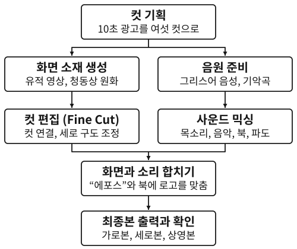
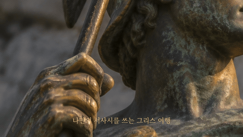

# ΕΠΟΣ

[**Cut 01 버전 비교 바로가기**](#cut-01-버전-비교) | [Cut Breakdown](#cut-breakdown)

**상영본** (16:9, 슬레이트와 크레딧 포함)

https://github.com/user-attachments/assets/e4713687-3120-4993-8d30-b76681030b91

**세로본** (9:16, 광고 본편 10초)

https://github.com/user-attachments/assets/ae2afcd8-8f46-401d-9403-5a33549ed19b

## 서비스 아이덴티티

[서비스 정체성]

ΕΠΟΣ(에포스)는 그리스 신화에 등장하는 이야기를 따라 실제 유적을 여행하는 코스를 추천하는 웹서비스다.

- **대상 고객:** 그리스 신화에 관심이 있고, 이야기 속 유적을 어디부터 돌아볼지 정하려는 여행자
- **USP (Unique Selling Proposition):** 명소의 인기 순위보다 신화 속 이야기의 흐름을 기준으로 유적을 고르고 방문 순서를 제안한다.
- **캠페인 목표(인지):** 광고를 본 사람이 “에포스는 그리스 신화 속 유적을 따라 걷는 여행 코스를 추천한다”고 설명할 수 있게 한다.
- **핵심 문구:** 나만의 서사시를 쓰는 그리스 여행.
- **화면 연출:** 신화를 판타지 장면으로 재현하기보다 여행자가 볼 만한 풍경을 실사풍으로 담았다. 돌을 딛는 샌들과 청동상의 손을 가까이서 보여 주고, 마지막에는 수니온의 신전과 바다를 한 화면에 담는다.
- **소리와 자막:** 남성 목소리가 그리스어로 말하면 노란 명조체 한글 자막이 뜻을 전한다. 마지막에는 “에포스”라는 발음과 낮은 북 한 번에 맞춰 바다 위에 ΕΠΟΣ 로고가 뜬다.

## 결과물

제출물: 10초 광고 본편 및 스토리보드. 세로본은 화면 비율 비교용이며, 별도 상영본은 슬레이트와 크레딧을 포함한 관람용이다.

| 용도 | 파일 | 규격 |
|---|---|---|
| 광고 본편 | [ΕΠΟΣ_광고.mp4](ΕΠΟΣ_광고.mp4) | 1280×720, 10.000초, 24fps, 240 frames |
| 스토리보드 | [ΕΠΟΣ_스토리보드.pdf](ΕΠΟΣ_스토리보드.pdf) | 서비스 아이덴티티, 컷별 10개 항목, 수정 기록 |
| 세로본 | [ΕΠΟΣ_세로.mp4](bonus/ΕΠΟΣ_세로.mp4) | 720×1280, 10.000초, 24fps, 240 frames |
| 별도 상영본 | [슬레이트와 크레딧 포함 MP4](bonus/EPOS_PICTURELOCK_SCREENING_CREDITS.mp4) | 1280×720, 12.042초, 289 frames |

## 제작 파이프라인

제작 기록을 바탕으로 소재가 다음 단계에 어떻게 쓰였는지 정리한 작업 흐름.

### 01 기획

- 서비스의 한 줄 소개와 캠페인 목표를 정했다.
- 10초를 여섯 컷으로 나누고, 컷마다 장소와 동작을 정해 생성 입력에 반영했다.

### 02 소재 생성

- Gemini에서 Cut 01의 v1과 v2를 생성했다. [V01](#v01)에 이어 [V02](#v02)에서는 양발이 바위턱을 떠나고 발과 바위 사이로 물이 보이도록 지시했다.
- [V03](#v03)으로 토리코스, 델포이, 미케네가 순서대로 들어간 영상 소스를 생성했다.
- 수니온의 [영어 요청](#v05)은 생성 오류로 끝났다. [두 번째 요청](#v04)에서는 영상 길이와 화면 속 신전의 위치 조건을 빼고, 고정된 카메라 앞에서 파도 한 줄이 절벽에 닿는 장면을 한국어로 요청해 영상을 얻었다.
- ChatGPT Images (ImageGen)로 [청동상 원화](#i01)를 생성했다. 기존 [올리브 원화](#i02)는 로고 질감에 쓸 명암 소재로 남겼다.
- Pocket TTS Greek에서 남성 내레이션 테이크를 생성해 사운드 편집용으로 넘겼다.

### 03 컷 편집 (Fine Cut)

- Cut 01의 v1과 v2를 비교해 도약 대신 v2의 착지 장면을 골랐다. 여행자가 바위를 딛고 앞꿈치로 체중을 옮기는 21 frames로 광고를 연다.
- 유적 영상에서 세 장소를 각각 잘라 토리코스, 델포이, 미케네 순으로 배치했다.
- 청동상은 원화 한 장을 썼다. 화면에 그린 화살표를 따라 가상 카메라가 창을 쥔 손에서 눈으로 천천히 올라가도록 편집했다.
- 발, 사자 부조, 신전과 포말이 세로 화면 안에 남도록 컷별 프레이밍을 조정했다.
- 가로와 세로에서 같은 시점인 `00:06.958`에 로고를 얹고, 올리브 원화의 명암을 로고 질감에 사용했다.

### 04 사운드

- 그리스어 테이크에서 본편에 쓸 구절과 마지막 브랜드 발화를 골라 배치했다.
- Suno의 기악곡을 깔고 내레이션과의 음량 균형을 맞췄다.
- 북은 합성해 추가하고, 파도는 Gemini 영상의 동반음과 합성층을 섞었다.
- 2초대에 배치했던 합성 날갯짓 소리는 최종 믹스에서 뺐다.

### 05 최종본 출력과 확인

- 16:9와 9:16의 10초 본편을 각각 출력하고, 슬레이트와 크레딧을 넣은 상영본을 별도로 출력했다.
- 세 영상의 해상도, 길이, 프레임 수와 AAC 오디오를 확인했다.
- 상영본과 세로본의 WebM 미리보기에서 화면과 스테레오 음성을 확인하고, README의 링크를 원본 MP4와 대조했다.

**Figure 1.** 10초 광고 제작 흐름: 컷 기획부터 최종본 출력까지

## Cut Breakdown

타임코드는 **10초 광고 본편** 기준이다. `00:00.000`에 Cut 01이 시작되고, `00:00.875`에 화면이 샌들에서 Cut 02의 토리코스 극장으로 바뀐다.

| 컷과 화면 | 본편 타임코드 | 생성 도구 | 입력 프롬프트 |
|---|---|---|---|
| **Cut&nbsp;01** 샌들 타이트 | `00:00.000` ~ `00:00.875` | Gemini 영상 | [V02](#v02) |
| **Cut&nbsp;02** 토리코스 극장 | `00:00.875` ~ `00:02.458` | Gemini 영상 | [V03](#v03) |
| **Cut&nbsp;03** 델포이 유적 | `00:02.458` ~ `00:03.708` | Gemini 영상, Pocket TTS Greek | [V03](#v03), [A01](#a01) |
| **Cut&nbsp;04** 미케네 사자의 문 | `00:03.708` ~ `00:04.250` | Gemini 영상, Pocket TTS Greek | [V03](#v03), [A01](#a01) |
| **Cut&nbsp;05** 청동상 | `00:04.250` ~ `00:05.667` | ChatGPT Images (ImageGen), Pocket TTS Greek | [I01](#i01), [A01](#a01), [A02](#a02) |
| **Cut&nbsp;06** 수니온 곶 | `00:05.667` ~ `00:10.000` | Gemini 영상, RealVisXL, Pocket TTS Greek | [V04](#v04), [I02](#i02), [A02](#a02), [A03](#a03) |

#### Edit Notes by Cut

- **Cut 01** 샌들이 돌을 밀어내는 동작만 남겼다. 세로본은 발을 따라 구도를 왼쪽으로 옮겼다.
- **Cut 02** 돌 객석이 낮은 사선으로 뻗어 있는 구간을 골랐다. 세로본의 지명은 화면 중앙에 놓았다.
- **Cut 03** 객석에서 산기슭의 석주와 돌길로 넘어간다. `00:03.333`부터 그리스어 내레이션이 들린다.
- **Cut 04** 세로본에서는 사각 출입구 위의 사자 부조가 가운데 오게 했다. `00:04.250`에 돌문에서 청동상의 손으로 컷을 넘긴다.
- **Cut 05** 원화 한 장에서 창을 쥔 손과 얼굴을 차례로 보여 준다. 얼굴에 이르면 `00:05.667`에 수니온의 바다로 넘어간다.
- **Cut 06** 세로본은 `00:05.750` ~ `00:06.375`에 위아래로 화면을 넓힌다. `00:06.958`에 “에포스”라는 목소리, 북소리, 로고가 함께 들어온다. 올리브 원화의 명암을 입힌 로고는 `00:10.000`까지 남는다.

## Version Comparison

#### Cut 01 버전 비교

왼쪽은 **v1 기본 요청**, 오른쪽은 **도약 조건을 추가한 v2**. 두 생성본의 `00:00.000` ~ `00:04.500` 구간을 같은 속도로 재생한다.

- **v1** [입력 프롬프트 V01](#v01): 샌들이 돌을 밀면 카메라가 뒤로 빠지고 인물의 날개가 펼쳐지도록 했다. 첫 프레임부터 뒤꿈치가 바위에 닿아 있다.
- **v2** [입력 프롬프트 V02](#v02): 양발이 바위턱을 떠나고 발과 바위 사이로 물이 보여야 한다는 문장을 더했다. 실제 영상에서는 도약 대신 샌들이 바위를 밀고, 카메라가 뒤로 빠지면서 날개가 펼쳐진다.
- **본편에 쓴 부분:** v2에서 발을 디디고 앞꿈치로 돌을 미는 21 frames(원본 `F010` ~ `F030`)만 썼다. 본편 `00:00.875`에는 날개 대신 첫 여행지인 토리코스 극장이 나온다.

**비교에 사용한 원본 파일**

- v1: `EPOS-v09-Gemini-opening-original.mp4`
- v2: `EPOS-v09-Gemini-opening-v2-original.mp4`

#### Cut 05 청동상: 카메라 무빙 연출

[원화 프롬프트 I01](#i01)에서 먼저 카메라가 지나갈 두 지점을 정했다. 창을 쥔 오른손은 화면 왼쪽에서 45%, 위에서 66% 지점에, 얼굴은 왼쪽에서 56%, 위에서 25% 지점에 두도록 했다. 창대는 왼쪽 아래에서 비스듬히 올라가고, 얼굴과 눈은 그 옆으로 드러나도록 요청했다.

- **v21: 화면 이동.** 한 장의 원화에서 잘라 보여 주는 영역을 손에서 얼굴 쪽으로 옮겼다. 손과 얼굴은 한 평면 위에서 함께 움직였다.
- **v22: 깊이와 초점 이동.** 원화에 깊이 정보를 준 2.5D 무빙을 시험했다. 앞에 있는 손과 창대, 그 뒤의 얼굴 사이에 거리감을 만들고, 카메라가 올라가는 동안 어느 거리의 윤곽을 가장 선명하게 보여 줄지도 바꿨다.
- **본편: 화살표를 따라가는 카메라.** 시작 구도는 v22의 `F111`을 기준으로 잡았다. 화면에 그린 빨간 화살표는 **손에서 출발 → 오른쪽으로 이동 → 눈을 향해 상승**하라는 편집 지시였다. v25에서는 시작 프레임의 깊이와 초점을 고정하고 가상 카메라만 오른쪽으로 183px, 위로 179px 옮겼다. 손에서 눈까지 속도가 부드럽게 이어지도록 조절했다. 아래는 이 무빙이 들어간 본편 `00:04.250` ~ `00:05.667`의 34 frames이다.

#### Cut 06 수니온: 생성 요청과 화면 비율

[V05](#v05)는 영어로 4초를 지정하고, 신전은 오른쪽 위에, 빈 수면은 화면 아래 절반에 두도록 했다. 기와지붕과 긴 열주까지 지정한 이 요청은 오류로 끝났다. [V04](#v04)에서는 한국어로 고정 카메라, 절벽 위 신전, 절벽에 닿는 파도 한 줄만 남겨 영상을 얻었다.

**가장 유력한 수정은 ‘정확히 4초’라는 조건을 뺀 것이다.** 파도가 절벽에 닿는 동작은 두 요청에 공통이지만, 두 번째 영상의 다운로드 기록에 남은 길이는 10.03초다. 언어를 바꾼 것보다 길이와 세부 구도를 열어 둔 것이 유효했다는 쪽에 무게를 뒀다. 덕분에 파도가 부서지는 순간을 편집에서 고를 수 있었다. 첫 요청에는 일반 오류만 표시돼 일시적인 서비스 장애도 가능한 설명이다.

왼쪽은 **16:9 가로본**, 오른쪽은 **9:16 세로본**이다. 같은 `00:05.667` ~ `00:08.167` 구간이다. 세로본에서는 왼쪽 수평선 일부가 빠지는 대신 신전과 포말이 함께 남는다. 두 화면 모두 `00:06.958`에 로고가 뜬다. 화면 비율을 바꿔도 컷 경계, 전체 길이, 음향은 같다.

#### 가로 본편과 세로본 대조

<table>
  <thead>
    <tr><th scope="col">항목</th><th scope="col">가로 본편</th><th scope="col">세로본</th></tr>
  </thead>
  <tbody>
    <tr><td>파일</td><td>ΕΠΟΣ_광고.mp4</td><td>bonus/ΕΠΟΣ_세로.mp4</td></tr>
    <tr><td>화면 비율 및 해상도</td><td>16:9, 1280×720</td><td>9:16, 720×1280</td></tr>
    <tr><td>길이</td><td>10.000초</td><td>10.000초</td></tr>
    <tr><td>프레임</td><td>24fps, 240 frames</td><td>24fps, 240 frames</td></tr>
    <tr><td>영상 및 오디오 포맷</td><td colspan="2" align="center">H.264,&nbsp;AAC&nbsp;48&nbsp;kHz&nbsp;Stereo</td></tr>
    <tr><td>브랜드 노출</td><td>00:06.958–00:10.000</td><td>00:06.958–00:10.000</td></tr>
    <tr><td>AAC stream</td><td colspan="2" align="center">470&nbsp;packets</td></tr>
  </tbody>
</table>

## Credits and Usage

**기획, 제작, 연출:** Yesung Lim, ChatGPT dots Zelda

| 담당 도구 | 맡은 작업 |
|---|---|
| ChatGPT | **카피와 구성** 여행 카피, 컷별 목표와 편집안을 작성했다. |
| Google Gemini | **영상** Cut 01의 샌들 장면, 세 유적, 수니온 해안의 영상 원본을 만들었다. |
| ChatGPT Images (ImageGen) | **청동상 원화** 창을 쥔 손과 투구 아래 눈이 한 장에 들어오도록 가상의 청동상 원화를 생성했다. |
| RealVisXL V5.0 Lightning | **로고 질감** 올리브 원화를 생성했다. ΕΠΟΣ 글자에는 이 원화의 명암만 사용했다. |
| Pocket TTS Greek | **그리스어 내레이션** 여행 문구와 마지막 “에포스”를 남성 목소리로 합성했다. |
| Suno v6-MINI | **음악** 기악곡 〈Setting Sail for the Aegean〉을 사용했다. |
| Codex Python, NumPy, SciPy | **효과음** 감쇠 파형과 필터 노이즈에 지연과 컨볼루션 잔향을 더해 북소리를 만들었다. 파도는 Gemini 영상에 담긴 소리와 합성음을 섞었다. |
| Pillow, FFmpeg | **조판과 최종 편집** 자막과 로고를 배치하고 화면과 소리를 합쳤다. |

**화면에 쓴 서체**

| 쓰인 곳 | 서체 |
|---|---|
| 광고 본편 | GFS Didot, Noto Serif CJK KR, Noto Sans CJK KR |
| 슬레이트와 크레딧 | Nimbus Sans Narrow, JetBrains Mono, OpenAI Sans |

**출처와 이용 범위**

- **카피:** 스토리보드 15쪽에는 장면 목표와 여행 카피를 다듬은 도구로 Codex가 기록돼 있다. 최종 한글 자막에는 제작자의 수정본을 반영했다.
- **영상:** 직접 촬영한 영상이나 유료 스톡 대신 생성 소재를 썼다. Gemini 표기는 편집했으며, 표기가 남아 있는 생성 원본과 출처 기록은 보존했다. 성공한 생성본은 세부 모델 ID 대신 도구명 Gemini로 표기했다. COPA 호출은 오류로 끝났다. 네이토, Flow, LTX에서는 편집에 쓸 결과물을 확보하지 못했다.
- **음성:** Myned AI와 Kyutai의 Pocket TTS Greek 모델을 사용했다. 모델 라이선스는 CC BY 4.0이다.
- **음악:** 이 영상은 비상업 학습용으로 제작했다. 곡의 사용 범위는 [Suno의 비상업 이용 안내](https://help.suno.com/en/articles/9601601)와 [스토리보드 15쪽](ΕΠΟΣ_스토리보드.pdf#page=15)에 기록했다.

## 실제 프롬프트

#### V01

영상 생성: Cut 01 v1

**[원문 (.txt)](prompts/V01.txt)**

고대 그리스 신화를 따라 들어가는 가로 여행 광고의 첫 장면을, 컷 없이 이어지는 실사풍 동영상 한 편으로 만들어 줘. 낮은 카메라 앞에서 가죽 샌들을 신은 성인 여행자의 발 한쪽이 거친 석회암을 한 번 단단히 디디고 앞꿈치로 땅을 민다. 그 순간 카메라가 즉시 뒤로 빠져 인물의 등을 잠깐 스치고, 그 등에서 아이보리색 깃털 날개 한 쌍이 한 번 펼쳐진다. 바로 이어 가까운 암반이 빠르게 화면 옆으로 지나가며, 멀리 아티카 반도의 실제 같은 낮은 능선과 푸른 에게해의 큰 원경이 드러난다. 날개가 열린 뒤에는 인물보다 해안이 화면을 차지한다. 오후의 자연스러운 옆빛, 바위의 질감과 수평선의 거리감을 살려 실제 영화 카메라로 움직인 듯하게. 발이 두 번 반복해서 나오거나 카메라가 끊기거나 인물 얼굴이 보이지 않게. 화면 글자, 현대 소품, 음악은 넣지 마.

#### V02

영상 생성: Cut 01 v2에 도약 조건 추가

**[원문 (.txt)](prompts/V02.txt)**

고대 그리스 신화를 따라 들어가는 가로 여행 광고의 첫 장면을, 컷 없이 이어지는 실사풍 동영상 한 편으로 만들어 줘. 낮은 카메라 앞에서 가죽 샌들을 신은 성인 여행자의 발 한쪽이 거친 석회암을 한 번 단단히 디디고 앞꿈치로 땅을 민다. 이때 양발이 모두 바위턱을 벗어나고, 등에서 날개가 펴지는 동안 인물은 바다 쪽으로 계속 전진해 두 발과 뒤쪽 바위턱 사이로 물이 보이는 간격이 넓어진다. 그 순간 카메라가 즉시 뒤로 빠져 인물의 등을 잠깐 스치고, 그 등에서 아이보리색 깃털 날개 한 쌍이 한 번 펼쳐진다. 바로 이어 가까운 암반이 빠르게 화면 옆으로 지나가며, 멀리 아티카 반도의 실제 같은 낮은 능선과 푸른 에게해의 큰 원경이 드러난다. 날개가 열린 뒤에는 인물보다 해안이 화면을 차지한다. 오후의 자연스러운 옆빛, 바위의 질감과 수평선의 거리감을 살려 실제 영화 카메라로 움직인 듯하게. 발이 두 번 반복해서 나오거나 카메라가 끊기거나 인물 얼굴이 보이지 않게. 화면 글자, 현대 소품, 음악은 넣지 마.

#### V03

영상 생성: 세 유적을 한 번에 요청한 프롬프트

**[원문 (.txt)](prompts/V03.txt)**

16:9 가로 여행 광고 편집용 10초 동영상. 실제 고대 그리스 유적을 찾아가고 싶게 만드는, 살아 움직이는 실사풍 촬영 소스만. 서로 다른 세 장소의 세 쇼트를 순서대로 담고 장면 사이에는 눈에 띄는 하드 컷만 두세요. 한 장소 안에서 세 장면을 이어 본 것처럼 보이면 안 됩니다. 
0–3초: 토리코스 고대 극장. 낮은 황토색 석회암 객석의 한 줄을 따라 왼쪽에서 오른쪽으로 짧게 이동하며, 정반원이 아닌 길쭉하고 한쪽이 각져 꺾인 객석 전체와 뒤편 낮은 아티카 해안이 열린다. 꺾이는 객석 끝이 화면 중앙보다 조금 오른쪽에 남는다. 
3–6초: 델포이 아폴론 성역. 앞 돌길의 대각선 끝에서 시작해 짧게 전진하며, 산비탈을 따라 층층이 놓인 유적과 파르나소스 산의 거대한 회색 암벽을 함께 드러낸다. 여행자가 실제로 볼 수 있는 유적의 현재 모습으로, 지붕 있는 상상 신전 대신 낮은 돌기단과 남은 기둥만. 산 속 약간 높은 앵글로 바다 없이. 
6–10초: 미케네 사자의 문. 미케네의 거대한 불규칙한 돌을 쌓은 성벽 사이로 비스듬히 전진하다가 짙고 각진 사각 입구와 커다란 돌 인방이 화면 정면에 드러난다. 인방 위 돌 삼각형에 중앙 기둥과 마주 보는 두 머리 없는 사자 부조가 있다. 사자 부조를 중앙보다 약간 오른쪽에 두고 실제 유적의 거칠고 무거운 돌 감촉을 살린다. 로마식 둥근 아치, 살아 움직이는 사자, 가상의 건물은 없다. 
세 장소가 한눈에 다른 실루엣. 돌·빛·관성은 실제 영화 카메라처럼. 화면 글자, 로고, 내레이션, 음악, 전경 인물, 몬스터, 날개, 변신, 장면 모핑, 디졸브, 정지 이미지 패닝은 넣지 마세요.

#### V04

영상 생성: 수니온 영상을 얻은 한국어 요청

**[원문 (.txt)](prompts/V04.txt)**

해 질 무렵 에게해 풍경을 가로 동영상 한 편으로 만들어 줘. 고정된 카메라 앞에서 파도 한 줄이 옅은 석회암 절벽에 닿는다. 절벽 위에는 고대 그리스 도리아식 신전이 서 있다. 실제 카메라로 촬영한 듯한 자연스러운 빛과 바다의 움직임.

#### V05

영상 생성: 오류가 난 수니온 영어 요청

**[원문 (.txt)](prompts/V05.txt)**

Generate one 4-second landscape video, 16:9, in a photoreal live-action cinematic style. A locked wide camera just above the Aegean looks toward the limestone headland at Cape Sounion at dusk. One wave reaches the cliffs. The intact Classical Greek Temple of Poseidon sits on the upper right with a tiled roof and a long Doric colonnade. Keep the uninterrupted dark blue water in the lower half clear, and hold the architecture steady. Low warm sunlight on textured stone. No people, writing, graphics, or music.

한국어 해석 (참고용)

16:9 가로 화면의 4초 영상 한 편을 실사 영화처럼 만들어 줘. 에게해 수면 바로 위에 고정한 광각 카메라가 해 질 무렵 수니온 곶의 석회암 돌출부를 바라본다. 파도 한 줄이 절벽에 닿는다. 화면 오른쪽 위에는 기와지붕과 길게 늘어선 도리아식 열주를 갖춘 고전기 그리스의 포세이돈 신전이 온전한 모습으로 서 있다. 화면 아래 절반의 짙푸른 바다를 가리는 요소 없이 유지하고, 건축물이 흔들리지 않게 해 줘. 낮게 드는 따뜻한 햇살이 돌의 질감을 비춘다. 인물, 글자, 그래픽, 음악은 넣지 마.

#### I01

이미지 생성: 청동상 원화

**[원문 (.txt)](prompts/I01.txt)**

Use case: historical-scene. Generate ONE new landscape 3:2 high-resolution production photograph to serve as the plate for a half-second editorial camera rise in a premium travel film about ancient Greece. A clearly inanimate, original imagined ancient Greek bronze statue (not a named or identifiable artifact) of a helmeted young adult warrior. Oblique three-quarter side-light. Composition is very deliberate: statue's sculptural face has readable nose, eye and helmet at x=56%, y=25%; the cast bronze right hand is unmistakably gripping a long plain ancient spear shaft at x=45%, y=66%; the spear runs obliquely from bottom left into upper middle but crosses neither the face nor the eyes. Both face and hand must be fully present, near the central strip of the image so that moving crops read in both 16:9 and vertical. Medium-tight photograph contains the sculpture from helmet crest to mid torso, no whole-body statue. Strong, finely detailed hands and face: no melted fingers, no skin, no expression that looks alive. Worn deep green-black patina and burnished bronze glints. Warm low late-afternoon Mediterranean sunlight rakes from upper right matching a limestone cliff at sunset, blurred cool slate-blue shadow and quiet limestone behind. Tonal contrast like a RED cinema-camera close-up, tactile and restrained, realistic highlight rolloff, barely any visible museum or location. No red backdrop, no heroic fantasy or combat, no CGI gloss, no text, no emblems, nobody else. This is an original sculpture concept; do not recreate any existing reference photograph.

한국어 해석 (참고용)

용도: 역사 장면. 고대 그리스를 다룬 고급 여행 영상에서 편집으로 카메라를 반초 동안 위로 움직이는 데 쓸 원판으로, 3:2 가로 비율의 고해상도 제작용 사진 한 장을 새로 만들어 줘. 투구를 쓴 젊은 성인 전사의 고대 그리스 청동상으로, 살아 있지 않은 조각상임이 분명해야 한다. 이름이 있거나 식별 가능한 유물이 아닌, 새로 상상한 조각상이다. 옆에서 비스듬히 비추는 3분의 4 방향 조명. 구도는 정확해야 한다. 조각상의 코와 눈, 투구가 x=56%, y=25% 지점에서 분명히 보여야 한다. 주조한 청동 오른손은 x=45%, y=66% 지점에서 장식 없는 긴 고대 창대를 확실히 쥔다. 창은 왼쪽 아래에서 위쪽 중앙으로 비스듬히 뻗되 얼굴이나 눈을 가로지르지 않는다. 얼굴과 손은 모두 온전히 보이고 화면 중앙 세로 띠 가까이에 있어야 한다. 그래야 크롭 위치를 옮겨도 16:9와 세로 화면 모두에서 알아볼 수 있다. 투구 볏에서 몸통 중간까지 담는 다소 타이트한 사진으로, 전신상은 보이지 않는다. 손과 얼굴의 형태는 선명하고 세밀해야 한다. 손가락이 녹아 붙은 듯 보이거나 피부가 드러나거나 살아 있는 듯한 표정은 없어야 한다. 짙은 녹흑색 녹청은 닳아 있고, 윤이 난 청동은 빛을 반사한다. 해 질 무렵 석회암 절벽에 드는 빛처럼, 늦은 오후 지중해의 따뜻하고 낮은 햇살이 오른쪽 위에서 표면을 스친다. 뒤쪽에는 흐릿하고 서늘한 슬레이트 블루 그림자와 차분한 석회암이 있다. RED 영화 카메라의 클로즈업 같은 명암 대비. 재질의 촉감을 살리되 과하지 않게 하고, 밝은 부분의 계조는 실제처럼 부드럽게 이어지게 한다. 박물관이나 촬영 장소임을 짐작할 만한 요소는 거의 보이지 않는다. 붉은 배경, 영웅 판타지나 전투, CGI 같은 번들거림, 글자, 상징 표식, 다른 인물은 넣지 마. 새로 만든 조각상 콘셉트이므로 기존 레퍼런스 사진을 재현하지 마.

#### I02

이미지 생성: 올리브 원화

**[원문 (.txt)](prompts/I02.txt)**

Optical macro photograph of one slender olive twig on the Greek coast. A few long narrow dusty grey-green olive leaves, sage silver undersides and visible veins. Low white sun peeks through two overlapping leaves near upper right, producing a small, real warm lens flare over distant turquoise sea. Wind lifts the pointed leaf ends, gentle depth of field and natural tones. No fruit, no writing, no diagram.

한국어 해석 (참고용)

그리스 해안의 가느다란 올리브 가지 하나를 광학 매크로 사진으로 담아 줘. 길고 좁은 잎 몇 장은 탁한 회녹색이고, 뒷면은 세이지빛이 도는 은색이며 잎맥이 보인다. 화면 오른쪽 위에서 겹친 잎 두 장 사이로 낮은 흰 해가 내다보이고, 멀리 보이는 청록색 바다 위로 작고 자연스러운 따뜻한 렌즈 플레어가 생긴다. 바람이 뾰족한 잎 끝을 들어 올린다. 심도는 부드럽게, 색감은 자연스럽게. 열매, 글자, 도식은 넣지 마.

#### A01

음성 생성: 그리스어 내레이션의 첫 구절

**[원문 (.txt)](prompts/A01.txt)**

Για να γράψεις τη δική σου ιστορία.

#### A02

음성 생성: 그리스어 내레이션의 둘째 구절

**[원문 (.txt)](prompts/A02.txt)**

Ένα ταξίδι στην Ελλάδα.

#### A03

음성 생성: 마지막 “에포스”를 발췌한 전체 테이크

**[원문 (.txt)](prompts/A03.txt)**

Γράψε το έπος σου στην Ελλάδα. Έπος.

#### T01

텍스트 생성: 이전 버전에서 화면 문구와 발화를 정할 때 쓴 입력

**[원문 (.txt)](prompts/T01.txt)**

화면전체가로가 이러면 
|     나만의 서사를 쓰는                    그리스 여행     |  이렇게 촥촥 나만의 서사를 쓰는 1번 그리스여행 2번으로 뜨고 화면 꽉체우게 에포스 뜨면안돼? 저 로고?  로고 꽉차는건 이정도 이상을 상상했어 지금도 별로 눈에 띄진않잖아 내가 준레퍼도

## BONUS

<table>
  <thead>
    <tr><th scope="col" nowrap>번호</th><th scope="col">항목</th><th scope="col">결과</th><th scope="col" nowrap>수행 여부</th></tr>
  </thead>
  <tbody>
    <tr><td>01</td><td>입 모양과 대사 동기화</td><td>화면 밖 내레이션만 사용.</td><td></td></tr>
    <tr><td>02</td><td>도구별 생성 결과 비교</td><td>비교본 X</td><td></td></tr>
    <tr><td>03</td><td>16:9와 9:16 비교</td><td><a href="ΕΠΟΣ_스토리보드.pdf#page=22">같은 프레임의 구도 비교</a>.</td><td align="center">✓</td></tr>
    <tr><td>04</td><td>Google Apps Script API 호출</td><td>실제 호출이나 예외 적용 X</td><td></td></tr>
  </tbody>
</table>

## 파일 검증

| File | SHA-256 |
|---|---|
| ΕΠΟΣ_광고.mp4 | `437e0e20fa312670d1ab505a0696e12280404b72326df8f503d753c3ef6c5b14` |
| bonus/ΕΠΟΣ_세로.mp4 | `65fbad57ad9ef6827456e508446ec865765694524b1a418b8a4e7502b2739324` |
| bonus/EPOS_PICTURELOCK_SCREENING_CREDITS.mp4 | `0cf7e63cafd1fc8af4b11ae0b50635f6bb6b31b150d21177cbd730297720baef` |
