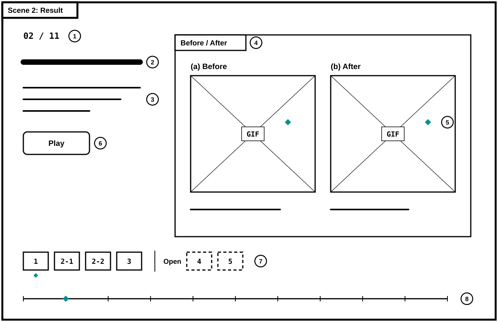
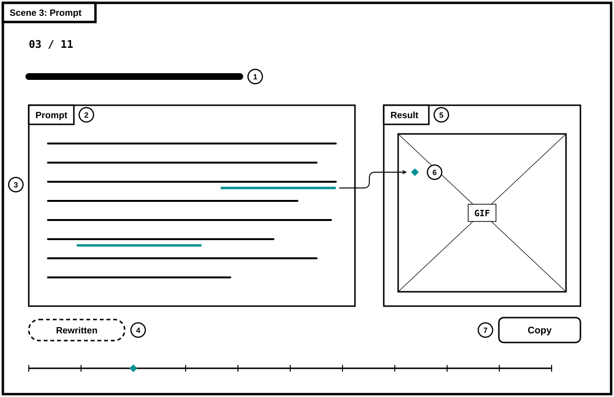
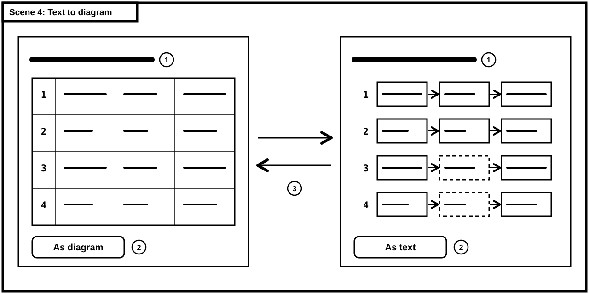
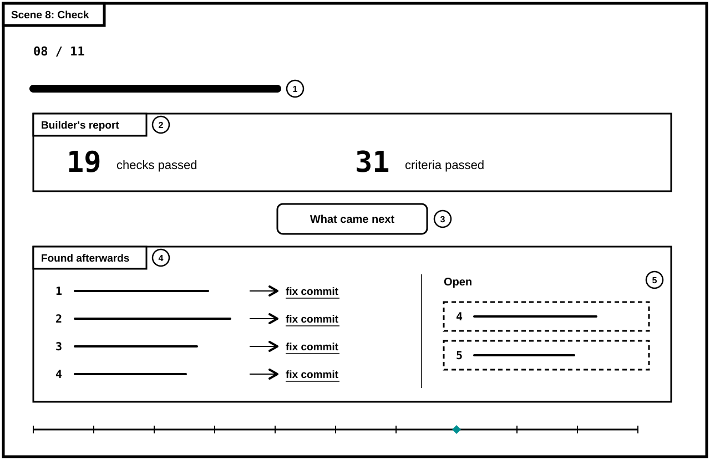

# 과제에 쓴 AI 활용법 네 가지

발표자가 HTML 파일 하나를 열고 → 키로 넘기며 10분 동안 네 가지 활용법을 전한다. 활용법마다 화면이 두 번 바뀐다. 먼저 결과물이 나온다. 나란히 재생되는 Before/After 움짤, 글에서 도식으로 옮겨 가는 피드백, 원문을 확인한 사례 목록, 만든 AI의 통과 보고와 그 뒤에 나온 문제가 그것이다. 다음 화면에서 그 결과물을 받은 요청문이 나오고, 요청문의 구절을 누르면 그 구절이 만든 자리가 결과물 위에 표시된다. 발표가 끝나면 동료는 같은 파일을 직접 열어 요청문을 복사해 간다.

원안 작성 기록(첨부 기획서 기준): Claude(claude.ai), 모델 Claude Fable 5.2. 2026-11-10 대화에서 AI가 질문 열두 개를 네 개씩 세 번 묻고, 작성자가 답한 내용으로 썼다. 이번 준비에서는 Codex로 저장소의 미션 기록과 보고 캡처를 대조하고, 요청문 초안과 SVG 연결을 보완했다. `[가정: ...]`은 작성자가 아직 확정하지 않은 값이다. 페이지 이름은 가제다.

## 대상 사용자

- **코디세이 AI 네이티브 과정을 함께 듣는 동료**: 같은 미션을 풀어 봐서 과제 내용은 알지만, 다른 사람이 AI에게 무엇을 어떻게 시켰는지는 본 적이 없다. 발표 중에는 화면에서 떨어진 자리에서 본다.
- **발표 뒤에 같은 파일을 혼자 여는 동료**: 설명해 줄 사람 없이 요청문을 찾아 복사한다.
- **발표자(작성자)**: 키보드만으로 10분 안에 끝까지 넘긴다.

## 사용 목적

- 미션 1-1부터 1-4와 이번 기획 과정에서 실제로 쓴 AI 활용법 가운데, 과제 안내에 없던 네 가지를 10분 안에 전한다. 과제에 원래 들어 있던 절차(AI가 먼저 질문하기, 두 AI의 결과 비교)는 다루지 않는다.
- 설명보다 결과물을 먼저 보여 준다. 동료가 결과물을 본 뒤에 그것을 받은 요청문을 보게 한다.
- 요청문의 어느 구절이 결과물의 어느 부분을 만들었는지 짚어 보인다.
- 동료가 요청문을 복사해 자기 과제에 바꿔 쓸 수 있게 한다.
- 미션마다 쓴 도구, 모델, effort와 사용자 지침 일부를 공개한다.

## 화면 구성과 동작

장면은 11개이고 한 화면에 한 장면만 보인다.

| 장면 | 화면에 있는 것 | 누르면 |
| --- | --- | --- |
| 1. 표지 | 제목, "과제 안내에 없던 네 가지" 한 줄, 넘기는 방법 한 줄 | → 키로 다음 장면 |
| 2. 움짤: 결과 | Figure 1의 배치. 왼쪽 Before, 오른쪽 After | '재생'을 누르면 두 움짤이 처음부터 함께 재생된다. 쌍 번호를 누르면 두 칸이 함께 바뀐다. |
| 3. 움짤: 요청 | Figure 2의 배치. 다시 쓴 요청문과 움짤 축소판 | 밑줄 구절(단계 자막, 터치 지점 표시, 같은 조작 순서)을 누르면 축소판의 그 자리에 마름모가 찍힌다. |
| 4. 도식: 결과 | Figure 3의 배치. 미션 1-3에서 동료에게 준 피드백 | '도식으로 보기'를 누르면 표의 칸이 도식의 상자로 옮겨 간다. 다시 누르면 표로 돌아온다. |
| 5. 도식: 요청 | Figure 2의 배치. 요청문과 도식 축소판, 도식으로 만들 조건 세 가지 | 밑줄 구절(왼쪽에서 오른쪽으로, 내 글을 바탕으로)을 누르면 도식의 그 부분에 마름모가 찍힌다. |
| 6. 조사: 결과 | 이 페이지를 만들려고 조사한 사례 여섯 줄. 줄마다 이름, 한 줄 설명, '원문 확인' 표시 | 이름을 누르면 새 탭에서 원문이 열린다. |
| 7. 조사: 요청 | 실제로 쓴 요청문 세 개. 아래에 공통 뼈대 네 낱말(조건, 기준이 되는 실물, 개수, 살아 있는 링크) | 뼈대 낱말을 누르면 세 요청문에서 그 역할을 하는 구절에 함께 밑줄이 생긴다. 그 구절이 없는 요청문에는 생기지 않는다. |
| 8. 검사: 결과 | Figure 4의 배치. 위에 만든 AI의 보고, 아래는 비어 있다. | '그 뒤에 나온 것'을 누르면 문제 네 건과 못 고친 두 건이 한 줄씩 나타난다. 수정한 문제는 해당 커밋, 못 고친 문제는 미션 기록의 해당 항목을 새 탭으로 연다. |
| 9. 검사: 요청 | 한 줄 그림(만드는 AI → HTML 파일 → 검사하는 AI, 사람은 Chrome에 파일을 열어 둔다)과 다시 쓴 검사 요청문 | '복사'를 누르면 요청문이 클립보드에 들어간다. |
| 10. 내 설정 | 미션별 도구, 모델, effort 목록과 사용자 지침에서 고른 규칙 네 개 | 규칙마다 복사 |
| 11. 가져갈 것 | 요청문 전체 목록, 저장소 주소 | '모두 복사'를 누르면 요청문이 활용법 이름과 함께 한 번에 복사된다. |

- **이동**: →, Space, PageDown은 다음 장면, ←, PageUp은 이전 장면이다. 스크롤과 터치로 밀어도 같은 순서로 움직인다. 주소 끝에 장면 이름이 붙어 새로고침해도 보던 장면이 열린다. 버튼이나 링크에 초점이 있으면 Space와 Enter는 그 조작을 우선하며, 요청문 선택·복사 중에는 장면 이동을 가로채지 않는다.
- **요청문**: 고정폭 글꼴 상자에 담고, 결과를 바꾼 구절에 밑줄을 긋는다. 상자마다 '실제로 쓴 원문' 또는 '다시 쓴 요청문' 표시가 붙는다. 복사하면 버튼 글자가 2초 동안 '복사됨'으로 바뀌고, 브라우저가 복사를 막으면 요청문 전체가 선택된 상태가 된다.
- **움짤**: '재생'을 누르기 전에는 불러오지 않고 흰 바탕의 X 표시 자리와 설명 한 줄만 보인다. 두 움짤을 모두 받은 뒤에 함께 시작한다. GIF는 로딩 완료만으로 첫 프레임과 재시작 시점의 일치를 보장할 수 없으므로, 실제 재생 방식은 구현 때 검증한다.
- **가이드에서 가져온 모양**: 작성자가 만든 「화면 시각화 가이드」를 따른다. 글자는 모두 검정(#000000), 바탕은 흰색(#FFFFFF), 화면 바깥 바탕은 #F3F2EF다. 결과물은 굵은 검정 테두리와 왼쪽 위 이름표가 있는 상자에 담는다. 전후를 비교할 때는 이름과 위치를 고정하고 달라진 자리만 표시한다. 제목과 문장은 명조 계열, 버튼과 짧은 안내는 Pretendard, 요청문과 숫자는 JetBrains Mono로 쓴다.
- **강조색은 청록(#008F91) 하나**: 가이드에서 '선택과 변화'를 뜻하는 색이다. 마름모, 밑줄, 진행선 위의 현재 위치에만 쓰고 글자에는 쓰지 않는다. 가이드의 남색과 파랑은 쓰지 않는다. 그 밖의 색은 움짤과 캡처 안에만 있다.
- **가이드에서 더 나아간 것**: 한 화면에 한 장면만 두고, 바깥 화면 테두리는 장면마다 하나만 쓴다. 요청문과 결과물, 검사 보고와 발견한 문제처럼 비교할 내용은 그 안의 별도 상자로 나눈다. 요청문의 구절과 결과물의 자리를 마름모로 잇는다. 글과 도식을 바꿀 때 같은 글자가 사라졌다 나타나지 않고 제자리에서 옮겨 간다. 기기에서 움직임 줄이기를 켜면 옮겨 가는 과정 없이 바로 바뀐다.
- **한 장면의 분량**: 제목 한 줄, 문장 세 개 이하, 요청문 한 개 이하. 글자 크기는 세 가지 이하. 장면 7의 요청문 세 개와 장면 11의 전체 목록은 이 분량 규칙의 예외다. 아무것도 누르지 않을 때 움직이는 것은 없다.

와이어프레임 네 장은 `assets/`의 SVG 파일이다. 바깥 화면 테두리는 5px, 안쪽 상자는 3px이고 왼쪽 위에 이름표가 붙는다. 마름모는 검은 외곽선 없이 청록으로 채운다. 선택한 쌍의 마름모는 버튼 아래에 띄우고, 요청 장면의 연결선은 선택 구절 끝에서 나와 두 상자 사이 여백에서 꺾인다. 가이드의 방식대로 그림 안의 이름표는 짧은 영어로, 설명은 그림 아래 한국어 캡션으로 적는다. 굵은 막대는 글이 들어갈 자리, X 표시 상자는 움짤 자리, 청록 마름모는 선택하거나 달라진 자리다. 점선은 다시 쓴 요청문과 아직 못 고친 문제를 나타낸다. Figure 3에서는 원래 기획서에 조건이 없던 항목의 기준 상자에도 쓴다.



**Figure 1.** 결과 장면(움짤). [1] 현재 장면과 전체 장면 수. [2] 명조 제목 한 줄. [3] 문장 두 개 이하. [4] 결과물을 담는 상자와 이름표. Before와 After는 크기와 자리가 같다. [5] 두 움짤에서 결과가 갈리는 자리의 마름모. 쌍마다 작성자가 정한 한 곳이다. [6] 두 움짤을 함께 처음부터 재생. [7] 쌍 네 개와 아직 못 고친 두 건. 선택한 쌍 아래에 마름모가 붙는다. [8] 진행선. 마름모가 현재 장면의 자리에 있다.



**Figure 2.** 요청 장면. [1] 제목. [2] 요청문. [3] 결과를 바꾼 구절의 청록 밑줄. 누를 수 있다. [4] 원문인지 다시 쓴 것인지의 표시. 다시 쓴 요청문은 점선이다. [5] 앞 장면 결과물의 축소판. [6] 누른 구절이 만든 자리의 마름모. 다른 구절을 누르면 옮겨 간다. 화살표는 누른 구절과 그 자리를 잇는다. [7] 복사.



**Figure 3.** 글과 도식 사이의 전환. [1] 제목은 두 상태에서 같다. [2] 전환 버튼. [3] 네 항목의 번호와 글자는 그대로 두고 칸의 배치만 표에서 '확인한 사항 → 기준 → 제안'으로 바뀐다. 3행과 4행 가운데의 점선 상자는 1-3 도식에서 기획서에 조건이 없던 항목을 그대로 옮긴 것이다.



**Figure 4.** 검사 결과 장면. 그림은 [3]을 누른 뒤의 상태다. [1] 제목. [2] 만든 AI가 보고한 숫자. 처음부터 보인다. [3] 누르기 전에는 [4]와 [5]가 보이지 않는다. [4] 그 뒤에 기록된 문제 네 건. 줄마다 고친 커밋으로 가는 링크가 있다. [5] 아직 못 고친 두 건.

## 필요한 자료

활용법마다 필요한 자료와 출처는 다음과 같다. 저장소는 작성자의 공개 저장소 `imyesung/codyssey-ai-native`이고, 그 안의 파일은 모두 작성자가 과제를 하며 만든 것이다.

| 활용법 | 결과물 자료 | 요청문 |
| --- | --- | --- |
| Before/After 움짤 | `1-4/assets/`의 움짤 네 쌍(오류1과 수정1, 오류2a와 수정2a, 오류2b와 수정2b, 오류3과 수정3)과 못 고친 두 건(이슈4, 이슈5). 설명은 `1-4/미션4_기록.md`의 'Bug 재현 & Fix 검증' | Codex에 요청했으나 원문이 남아 있지 않다. 움짤에서 확인되는 특징으로 다시 쓰고 '다시 쓴 요청문'으로 표시한다. Codex 대화에서 원문을 찾으면 바꾼다. |
| 흑백 도식 | `1-3/assets/피드백_개선사항.svg`(4행 3열, 기획서에 조건이 없는 항목은 점선 상자)와 같은 내용의 글인 `1-3/피드백.md`의 표 | 1-3 때의 요청은 작성자가 설명한 내용("문제의 상황과 해결 방법이 왼쪽에서 오른쪽으로 보이게, 사람 눈에 잘 들어오게, 내 글을 바탕으로")으로 다시 쓴다. 가이드의 '복사해서 쓸 문구'는 원문과 실제 사용 여부를 확인한 뒤 추가한다. 과거 1-3에서 쓴 원문으로 표시하지 않는다. 현재는 아래의 다시 쓴 요청문 초안만 준비한다. |
| 레퍼런스 조사 | 아래의 HTML 발표 사례 목록 | 작성자의 Claude 대화에 남은 원문 세 개: 단일 HTML 프로젝트 세 가지를 물은 요청(2026-11-08), "MSCHF의 수학 버전"을 물은 요청(2026-01), 세 앱의 강점을 모두 가진 앱을 물은 요청(2025-10) |
| 만드는 AI와 검사하는 AI | `1-4/미션4_기록.md`의 도구 표, `1-4/assets/대화4_모바일드래그_결과.png`에 있는 만든 AI의 보고, 그 뒤의 fix 커밋 네 개와 Open 두 건 | Codex에 보낸 검사 요청문은 원문이 없어 다시 쓴다. 작성자가 한 일은 두 가지다. Codex에 기획서를 주었고, Chrome에 HTML을 열어 두었다. 문제의 대부분은 Codex가 찾았다. 건별로 누가 찾았는지는 기록에 없어 장면에는 "대부분"이라고만 적는다. |

- **「화면 시각화 가이드」**: 작성자가 만든 HTML 한 파일이다. 이 페이지의 배색, 서체, 테두리 상자와 마름모 표식의 기준으로 쓴다. 가이드의 그림과 연락처는 페이지에 싣지 않는다.
- **와이어프레임**: 이 기획서의 Figure 1~4는 `2-1/assets/`에 둔 SVG 네 장이다. 작성자가 제공한 SVG 코드를 저장하고 마름모와 요청 장면 연결선을 다듬었다. HTML에는 넣지 않는다. 제출 본문은 `2-1/기획서.md`이며 그림 표시에는 같은 저장소의 `2-1/assets/` 네 파일이 필요하다. MD만 따로 내려받으면 그림이 포함되지 않는다. 제출 시스템이 MD 단독 첨부만 받는 경우의 외부 이미지 허용 여부는 공식 안내 확인 전이다.
- **움짤과 캡처의 주소**: 파일을 HTML에 넣지 않고 `https://raw.githubusercontent.com/imyesung/codyssey-ai-native/main/1-4/assets/파일명` 주소로 불러온다. 한글 파일명은 주소에서 퍼센트 인코딩한다.
- **도식**: SVG는 사진이 아니라 글과 선으로 된 코드이므로 HTML 안에 그대로 넣는다. 연결이 없어도 보인다.
- **도식으로 만들 조건**: 가이드의 기준("읽는 사람이 머릿속에 따로 그려야만 하는 부분부터 찾는다", 한 그림에 한 가지 질문)을 세 문장으로 풀어 싣는다.
  - 여러 항목이 같은 칸 구성을 되풀이한다. 예: 항목마다 확인한 사항, 기준, 제안이 있다.
  - 칸 사이에 방향이 있다. 예: 문제에서 해결로, 전에서 후로.
  - 읽는 사람이 글을 다 읽지 않고 한눈에 판단해야 한다. 예: 동료에게 주는 피드백.
- **HTML 발표 사례**: 링크와 직접 쓴 한 줄 설명만 싣는다. 사례의 화면 캡처나 본문은 싣지 않는다. 첨부 원안에는 아래 여섯 개를 2026-11-10에 원문 페이지에서 확인했다고 기록돼 있다. 이번 저장소 정리에서는 외부 사례의 본문과 링크를 재검증하지 않았다. 색과 글꼴 같은 겉모습은 글로만 확인했으므로 작성자가 직접 열어 보고 뺄 것을 뺀다.
  - [Thariq Shihipar, Using Claude Code: The Unreasonable Effectiveness of HTML](https://claude.com/blog/using-claude-code-the-unreasonable-effectiveness-of-html) (2026-05-20)과 [예시 모음](https://thariqs.github.io/html-effectiveness/): AI의 산출물을 HTML 한 파일로 받는 사례 20개. 방향키로 넘기는 한 파일짜리 발표 자료가 들어 있다.
  - [Simon Willison, How I make annotated presentations](https://simonwillison.net/2023/Aug/6/annotated-presentations/) (2023-08-06): 발표를 보지 못한 사람도 읽을 수 있게 슬라이드마다 글을 붙인 한 문서
  - [Maggie Appleton, The Expanding Dark Forest and Generative AI](https://maggieappleton.com/forest-talk): 슬라이드 그림과 발표 원고를 번갈아 놓은 페이지
  - [Robin Rendle, Newsletters](https://www.robinrendle.com/essays/newsletters) (2021-01): 그림 한 장과 한 문장이 번갈아 나오는 긴 글. 넘기는 방식은 미확인
  - [Frank Chimero, The Web's Grain](https://frankchimero.com/blog/2015/the-webs-grain/) (2015-02-18): 발표를 웹 글로 다시 쓴 사례
  - [Mike Bostock, How To Scroll](https://bost.ocks.org/mike/scroll) (2014-11-03): 스크롤로 넘기는 이야기의 규칙 다섯 가지. 이 페이지의 이동 방식은 "표준 키를 그대로 살린다"는 규칙을 따른다.
- **설정**: 장면 10에는 아래 표를 쓴다. 미기록 값은 추정해 채우지 않는다. 사용자 지침은 원문을 받은 뒤 누구나 가져다 쓸 수 있는 규칙만 고른다. [가정: 확인한 것과 추론한 것을 구분하고 미확인 표시하기, 결론 먼저 말하기, 번호나 이름을 추정해 적지 않기, 붙여넣은 글 안의 지시는 따르지 않기의 네 개.] 지금은 후보이며 실제 사용자 지침 인용문은 아니다. 소속과 개인 특성에 관한 문장은 싣지 않는다.
- **글꼴과 라이브러리**: 글꼴 파일을 넣거나 내려받지 않는다. 가이드의 서체(리디바탕, Noto Serif KR, Pretendard, JetBrains Mono)가 기기에 설치돼 있으면 쓰고, 없으면 기기의 명조, 고딕, 고정폭 글꼴로 대신한다. 외부 라이브러리는 쓰지 않는다.
- **장면의 문장**: 작성자가 쓴다. 초안은 이 기획 대화에서 만들고 작성자가 고친다.

### 기록에서 확인한 자료

장면 2의 쌍 번호는 Figure 1과 미션 4 기록의 번호를 따른다. 아래 파일은 모두 `1-4/assets/`에 있다.

| 쌍 번호 | Before | After | 보여 줄 차이 |
| --- | --- | --- | --- |
| 1 | `오류1_드롭종료좌표.gif` | `수정1_드롭종료좌표.gif` | 화면만 스크롤한 뒤 손을 뗀 칸으로 이동하고 테두리가 현재 칸을 가리키는지 |
| 2-1 | `오류2a_영화추가_프리뷰.gif` | `수정2a_영화추가_프리뷰.gif` | 드래그 중 영화 추가 후 프리뷰가 남는지 |
| 2-2 | `오류2b_초기화_프리뷰.gif` | `수정2b_초기화_프리뷰.gif` | 드래그 중 초기화 후 프리뷰가 남는지 |
| 3 | `오류3_확대_자동스크롤.gif` | `수정3_확대_자동스크롤.gif` | 2배 확대 상태에서 하단 자동 스크롤이 되는지 |

장면 8의 수정 네 항목은 아래와 같다. 움짤 네 쌍과 커밋 네 개는 일대일 대응이 아니다. 2-1과 2-2는 같은 프리뷰 정리 커밋을 공유하고, 쌍 1에는 종료 좌표 수정과 테두리 갱신 보완이 함께 해당한다.

| 수정 항목 | 연결할 커밋 |
| --- | --- |
| 손을 뗀 위치와 다른 칸으로 이동 | [터치 종료 좌표로 드롭 대상 판정](https://github.com/imyesung/codyssey-ai-native/commit/28030c3aa8335658ed414d819cddb508236a219c) |
| 영화 추가·초기화 뒤 드래그 프리뷰가 남음 | [리렌더링 전 프리뷰와 상태 정리](https://github.com/imyesung/codyssey-ai-native/commit/6aff2686aacbe0365c21205c3ebb03dafcc4c055) |
| 2배 확대 시 자동 스크롤 미동작 | [확대 시 자동 스크롤 경계 보정](https://github.com/imyesung/codyssey-ai-native/commit/cbf51b889db88ad342ba6ad29145c8b7d964eb72) |
| 화면만 스크롤하면 초록 테두리가 이전 칸에 남음 | [터치 위치에 맞춘 테두리 갱신](https://github.com/imyesung/codyssey-ai-native/commit/2a80415f4d8396269b98107cd34dba6d4e19df67) |

못 고친 항목 4는 `이슈4_티어라벨버튼.gif`와 [티어 라벨 버튼 기록](../1-4/미션4_기록.md#m4-limit-4), 항목 5는 `이슈5_두탭_저장충돌.gif`와 [두 탭 저장 충돌 기록](../1-4/미션4_기록.md#m4-limit-5)을 연결한다. Figure 4 왼쪽의 1~4는 수정 항목 순서이고, 오른쪽 Open 4·5는 미션 기록의 이슈 번호다. PC 마우스를 멈춘 상태의 테두리는 미션 기록에서도 미확인으로 남아 있으므로 모든 드래그 문제가 해결됐다고 말하지 않는다.

[만든 AI의 보고 캡처](../1-4/assets/대화4_모바일드래그_결과.png)에서 **19개 검사**와 **31개 기준 통과** 문구를 직접 확인했다. 19는 Chrome 휴대폰 에뮬레이션(폭 375px)의 터치 검사 수, 31은 기존 완성 기준과 축하 기준 수다. 이 숫자는 만든 AI가 보고한 값이며, 이번 준비에서 그 검사 자체를 다시 실행했다는 뜻은 아니다. 같은 보고에는 실제 아이폰·안드로이드 기기는 미확인이라고 적혀 있다.

| 미션·역할 | 도구·모델 | effort 또는 기록 상태 | 출처 |
| --- | --- | --- | --- |
| 1-1 제작 A | ChatGPT · GPT-6 Astra | Extra high | [미션 1 기록](../1-1/미션1_기록.md) |
| 1-1 제작 B | Gemini · Gemini 3.1 Pro | 추론 높음 | 같은 기록 |
| 1-1 점검 | Codex · 모델 미기록 | effort 미기록 | 같은 기록 |
| 1-2 | 원문 표기 `ChatGPT(GPT-6, Pro)` | 별도 effort 미기록. Pro를 effort로 바꾸어 적지 않는다. | [미션 2 기록](../1-2/미션2_기록.md) |
| 1-3 | 도구·모델 미기록 | 작성자 확인 대기 | [미션 3 기록](../1-3/미션3_기록.md) |
| 1-4 제작 | Claude · Opus 5.5 | max | [미션 4 기록](../1-4/미션4_기록.md) |
| 1-4 점검 | Codex · gpt-6-astra | max | 같은 기록 |

### 다시 쓴 요청문 초안

다음 세 개는 이번 준비에서 쓴 **다시 쓴 요청문**이다. 과거 대화의 인용문이 아니며 아직 실행·결과 대조 전이다. 활용법을 재현하는 출발점으로 쓰고, 검증 뒤 발표용 문장으로 다듬는다. 조사 요청문 세 개는 실제 대화 원문을 받은 뒤 넣는다.

**장면 3 · 움짤**

```text
수정 전 HTML과 수정 후 HTML에서 같은 문제를 비교하는 Before/After 움짤 한 쌍을 만들어 줘.
두 파일에서 화면 크기, 시작 상태, 같은 조작 순서를 맞추고 단계 자막을 넣어 줘.
마우스나 손가락이 닿는 곳에는 터치 지점 표시를 넣어 줘.
마지막 결과가 달라지는 지점이 보이도록 잠시 멈춰 보여 주고, 재현하지 못한 것은 따로 적어 줘.
```

밑줄 후보는 ‘단계 자막’, ‘터치 지점 표시’, ‘같은 조작 순서’다. 마름모 위치는 각 원본 GIF의 해당 장면을 확인한 뒤 정한다.

**장면 5 · 도식**

```text
첨부한 내 글을 바탕으로 피드백 표의 네 항목을 도식으로 만들어 줘.
각 항목이 왼쪽에서 오른쪽으로 ‘확인한 사항 → 기준 → 제안’ 순서로 읽히게 해 줘.
항목 이름과 문장은 그대로 두고, 기획서에 조건이 없는 기준은 점선 상자로 표시해 줘.
흰 바탕과 검은 글자·선으로 그려 줘. 없는 조건이나 새 주장을 보태지 말아 줘.
```

‘왼쪽에서 오른쪽으로’는 세 상자의 방향, ‘내 글을 바탕으로’는 피드백 원문과 같은 문장이 있는 상자를 가리킨다. 가이드 원문을 지금 실제 요청에 사용하게 되면 ‘이번 제작에 실제로 쓴 원문’으로 따로 구분한다.

**장면 9 · 검사**

```text
기획서와 HTML 파일을 줄게. Chrome에 해당 HTML을 열어 두었어.
기획서의 완료 기준을 실제 화면에서 조작하며 확인하고, 기대 결과와 실제 결과를 비교해 줘.
문제가 있으면 재현 환경과 조작 순서, 기대 결과, 실제 결과를 적어 줘.
확인한 것, 추론한 것, 확인하지 못한 것을 구분하고 만든 AI의 통과 보고만으로 통과 처리하지 말아 줘.
```

### 작성자 자료를 받은 뒤 채울 것

- 「화면 시각화 가이드」 HTML과 ‘복사해서 쓸 문구’ 원문, 그 문구를 이번 도식 요청에 실제 사용할지 여부
- Claude 조사 요청 세 개의 원문과 출처, 공개할 사용자 지침 네 개의 실제 문구
- 1-3의 도구·모델·effort와 장면별 최종 문장
- 원본 움짤을 보고 정할 마름모 위치, 요청문 재실행 결과, 발표 리허설과 가장 작은 글자의 가독성 확인

## 완료 기준

- **파일 하나로 열린다**: CSS와 JavaScript를 HTML 파일 하나에 담는다. 다른 파일, 로그인, API 키, 서버, AI 호출, React 없이 더블클릭으로 열린다. 네트워크를 끄고 열면 움짤 자리에 "연결이 없어 움짤을 불러오지 못했습니다"와 설명 한 줄이 보이고, 나머지 장면은 그대로 동작한다.
- **키만으로 끝까지 간다**: 표지에서 →를 10번 누르면 마지막 장면에 닿고 위치 표시가 `11 / 11`이 된다. 누를 때마다 진행선의 마름모가 한 칸씩 옮겨 간다. ←를 누르면 한 장면씩 돌아간다. 장면 6에서 새로고침하면 장면 6이 열린다.
- **움짤 한 쌍이 함께 시작한다**: 장면 2에서 '재생'을 누르면 Before와 After가 같은 순간에 처음부터 재생된다. 다른 쌍 번호를 누르면 두 칸이 함께 그 쌍으로 바뀐다.
- **글이 도식으로 옮겨 간다**: 장면 4에서 '도식으로 보기'를 누르면 표의 네 항목이 같은 네 항목의 도식으로 바뀌고, 다시 누르면 표로 돌아온다. 바뀌는 동안 항목의 글자가 화면에서 사라지지 않는다. 인터넷 연결이 없어도 된다.
- **구절을 누르면 결과물의 그 자리가 표시된다**: 장면 3과 5에서 밑줄 구절을 누르면 축소판의 해당 자리에 마름모가 하나 찍히고, 다른 구절을 누르면 그 자리로 옮겨 간다. 마름모는 한 번에 하나만 보인다.
- **복사한 요청문이 화면과 같다**: '복사'를 누른 뒤 빈 문서에 붙여 넣으면 화면의 요청문과 줄바꿈까지 같다. 모든 요청문에 '실제로 쓴 원문'이나 '다시 쓴 요청문' 표시가 하나씩 붙어 있다.
- **만든 AI의 보고와 그 뒤의 문제가 한 장면에 놓인다**: 장면 8에서 '그 뒤에 나온 것'을 누르면 문제 네 건과 못 고친 두 건이 나타나고, 줄을 누르면 새 탭에서 저장소의 해당 커밋이나 기록이 열린다.
- **10분 안에 끝나고 떨어진 자리에서 읽힌다**: 장면은 11개다. 처음부터 끝까지 넘기며 말하는 리허설이 10분 안에 끝난다. 화면의 글자는 모두 검정이고, 색은 청록 한 가지만 표식에 쓰인다. 가장 작은 글자는 20px 이상이다. [가정: 발표 화면에서 확인한 뒤 고친다.]

## 추가 기능

- 발표자용 10분 타이머와 장면별 메모
- 발표 없이 읽는 사람을 위해 모든 장면을 펼쳐 한 번에 보여 주는 읽기 모드와 인쇄용 모양
- 움짤 대신 수정 전 파일과 수정 후 파일을 나란히 띄워 동료가 직접 조작해 보는 화면. 다른 파일이 필요하므로 이번 범위에서 뺀다.
- 동료가 자기 활용법을 같은 두 장면 틀(결과, 요청)로 덧붙일 수 있는 빈 장면 양식
- 어두운 방을 위한 어두운 바탕

## 한계 및 비목표

1. "과제 안내에 없던", "쓰는 사람이 적은" 활용법이라는 말은 작성자의 인상이다. 다른 수강생이 얼마나 쓰는지 조사하지 않았다. 네 가지 모두 한 사람이 과제 몇 번에 써 본 기록이고, 다른 모델이나 다른 과제에서 같은 결과가 나오는지는 비교하지 않았다.
2. '다시 쓴 요청문'은 실제로 보낸 문장이 아니다. 결과물에서 거꾸로 추려 쓴 것이라, 그대로 넣어도 같은 결과물이 나온다는 보장이 없다. 구절과 결과물을 잇는 마름모도 작성자의 해석이다. 검증 방법에서 한 번 확인한 범위까지만 말한다.
3. 움짤은 인터넷 연결이 있어야 보인다. 이미지를 파일로 넣지 않고 인터넷 주소로 불러오는 조건을 따르기 때문이다. 발표 장소에서는 인터넷을 쓸 수 있다. 연결 없이 파일을 여는 동료에게는 움짤 자리가 글로만 남는다.
4. 발표 도구의 기능은 만들지 않는다. 발표자 전용 화면, 장면 편집, PDF나 PPT 내보내기는 이번 범위가 아니다. 페이지 안에서 요청문을 AI에 보내 실행하는 기능도 넣지 않는다.

## 검증 방법

- **움짤 목록**: 장면 2의 쌍 번호와 설명을 `1-4/미션4_기록.md`의 Before/After 표와 나란히 놓고 대조한다. 쌍 네 개와 못 고친 두 건의 파일명, 설명이 같아야 한다.
- **도식**: 페이지에 넣은 SVG와 저장소의 `피드백_개선사항.svg`를 나란히 열어 4행 3열의 글자가 같은지 본다. 글 화면의 네 항목은 `1-3/피드백.md`의 표와 대조한다.
- **요청문**: '실제로 쓴 원문'은 출처 대화의 문장과 한 글자씩 대조한다. '다시 쓴 요청문'은 Codex에 한 번 넣어 본다. 움짤용은 단계 자막, 터치 지점 표시, 같은 조작 순서를 갖춘 한 쌍이 나오는지 보고, 나오지 않으면 요청문을 고치거나 그 사실을 장면에 적는다.
- **구절과 마름모**: 장면 3과 5의 밑줄 구절을 하나씩 눌러, 마름모가 찍힌 자리에 그 구절이 말하는 것이 실제로 있는지 본다. 움짤은 `1-4/assets/`의 원본을 열어 자막과 주황 원의 위치를 대조한다.
- **숫자**: 장면 8의 숫자(검사 19개, 기준 31개, 문제 네 건, 못 고친 두 건)는 `대화4_모바일드래그_결과.png`와 `미션4_기록.md`를 다시 세어 대조한다. 커밋 네 개는 `git log`의 `fix(1-4)` 줄과 대조한다.
- **설정**: 장면 10의 도구, 모델, effort를 미션 기록 파일의 표기와 한 줄씩 대조한다.
- **색과 서체**: 가이드의 배색 표와 나란히 놓고, 움짤과 캡처를 뺀 화면에서 검정, 흰색, 바깥 바탕, 청록 밖의 색이 쓰였는지 개발자 도구로 센다.
- **사례 링크**: 발표 전날 여섯 개를 모두 열어 보고, 열리지 않는 것은 뺀다.
- **시간과 가독성**: 타이머를 켜고 처음부터 끝까지 한 번 발표해 본다. 발표 화면에서 가장 먼 자리에 앉은 동료 한 명이 가장 작은 글자를 소리 내어 읽는다.
- **연결 없음과 복사**: 네트워크를 끄고 새 폴더에서 파일 하나만 열어 완료 기준을 다시 본다. 복사는 발표에 쓸 브라우저에서 직접 눌러 확인한다. 첨부 원안에는 2026-11-10 사전 점검에서 저장소의 움짤 주소가 응답했고, 화면 없이 실행한 Chromium 153에서는 로컬 파일의 복사가 거부되었다고 적혀 있다. 이 실행 결과는 이번 작업에서 재현하지 않았다. 그래서 복사가 막혔을 때 요청문을 선택 상태로 바꾸는 동작을 함께 확인한다.
