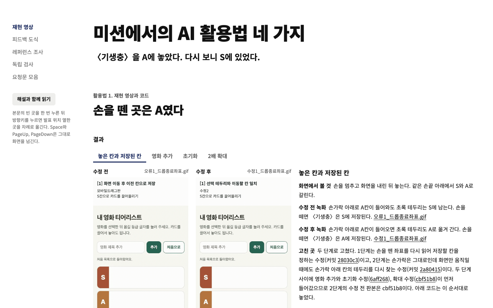
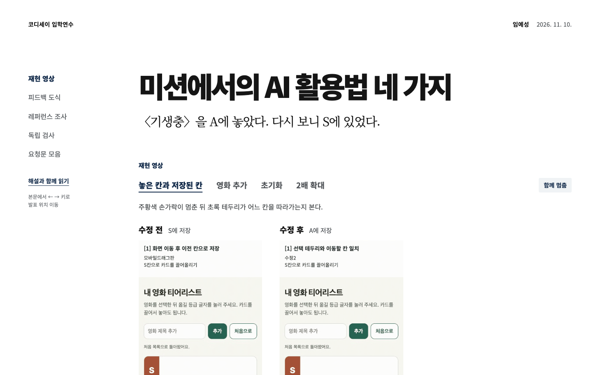

# 제작검증기록: Codyssey Mission AI 활용법

## 두 AI 비교

- AI A: OpenAI Codex, GPT-6 Astra, `xhigh`
- AI B: Claude Code, Claude Opus 5.5, `extra`
- 동일한 기획서와 함께 전달한 요청: 같은 `공통입력.zip`과 [최초 공통 기획서](참고/최초_공통기획서.md), 아래 제작 요청을 두 AI의 새 세션에 전달했다.

<details>
<summary>두 AI에 전달한 공통 요청 전문</summary>

```text
첨부한 공통입력.zip을 풀어 기획서.md와 assets/를 읽어 줘. 로컬 세션에서는 동일한 ZIP이 /tmp/codyssey-rev3/input/공통입력.zip에 있다.

너는 코디세이에서 10분 동안 상영하고 나중에 동료 혼자 읽을 수 있는 한국어 웹 글을 만드는 디자이너이자 개발자야. 기획서의 완료 기준을 충족하는 ‘미션에서의_AI_활용법_v1.html’ 전체를 하나의 완성된 HTML 파일로 만들어 줘. 계획이나 설명에서 멈추지 말고 완성 파일을 저장하거나 첨부해 줘. 첨부가 불가능한 환경에서만 전체 HTML을 한 코드 블록으로 반환해 줘.

1. HTML 안에 CSS와 바닐라 JavaScript를 넣어 줘. 더블클릭으로 작동해야 해. 서버, 빌드, 외부 라이브러리·글꼴, 로그인, API 키, 실행 중 AI 호출, 로컬 보조 파일은 사용하지 마. 과제 후보의 외부 사진, 녹화, 화면 캡처는 공개 HTTPS src를 써. 첨부한 로컬 자료는 대조와 제작용이야. 네트워크가 없어도 본문·코드·원본 도식·목차·복사는 작동하게 해 줘.
2. 흰 바탕과 넓은 여백, 왼쪽 목차, 넓은 그림과 좁은 본문으로 길게 읽는 문서로 만들어 줘. 발표 위치 열한 곳, 다섯 절, 활용법 네 가지를 지켜 줘. 하단 진행 바, 중첩 카드, 불필요한 테두리, 장식 배지와 요청문 편집기는 제외해. 모노스페이스는 실제 코드에만 써. 좁은 화면과 키보드 탐색·초점, 움직임 줄이기를 지원해 줘.
3. 네 사례 탭을 한 줄에 두고 하나를 고르면 해당 전후 녹화, 캡션, 수정 전후 코드 구간이 한꺼번에 바뀌게 해. 처음부터 한 시계의 0번 프레임에서 함께 재생하고 끝에서 함께 되감아 계속 반복해. 멈춤·재개는 한 버튼, 시스템 움직임 줄이기에서는 정지 상태로 시작해. 영상 실패는 화면에 표시해. 두 GIF의 독립적인 자연 재생을 동기화라고 가정하지 마. 관객이 고르는 세 개의 재생 지점은 두지 마.
4. cases.json의 양쪽 판본 코드와 실제 줄 링크를 쓰고 변경된 줄이 보이게 해. 원문의 문자를 HTML로 실행하지 말고 코드로 표시해. 첫 사례는 두 단계의 수정, 영화 추가·초기화는 다른 진입점과 같은 수정, 확대는 별도의 수정이야. 1-3의 figure.svg 원본은 한 번만 인라인으로 넣고 원문 표는 별도로 읽을 수 있게 해. 미니 도식을 새로 그리지 마.
5. 레퍼런스 절의 1인칭 원고 세 문단을 보존하고 바로 아래에 여섯 실제 사이트 캡처와 짧은 설명을 놓아 줘. 공통 출처표에서 각 사례의 remoteImage를 src로, remoteCaption을 그 장면 설명으로 써. JPG는 기획자와 함께 보는 상세 대목이므로 첫 화면의 캡션과 혼용하지 마. 저자·제목·원문 링크와 적용할 점을 붙여 줘. 일곱 번째 참고인 OpenAI를 그 여섯에 더하지 마.
6. 여섯 개의 ‘다시 쓴 요청문’과 네 개의 공유 지침은 기획서 문구·순서·줄바꿈을 보존해. 마지막에 개별 복사·전체 복사 및 수동 복사 방법을 줘. Gemini 검사 참고 요청은 과거 여섯 건과 별도로 실어. 당시 제작 AI의 19/31 보고, 수정 네 건, 미해결 두 건, 중간 판본의 코드 재현, 실제 녹화, 실물 기기 미확인을 정확히 구분해. 새 Gemini 예시를 실행한 결과라고 쓰지 마.
7. 시간이 허락하면 본문·장면 위치를 유지하는 ‘해설과 함께 읽기’를 구현해 줘. 기본 여섯 캡처나 영상, 코드, 복사 기능을 희생하지 마. 읽기판에서는 정지 장면 곁에 새 해설을 놓고 인쇄에서는 결과를 모두 읽을 수 있게 해.
8. 전달하기 전 HTML의 코드·콘텐츠를 확인해. 실제 브라우저로 열 수 있는 경우 기획서의 T1~T3을 실행해. 직접 확인한 범위만 별도 짧은 글로 알려 줘. 미실행·자료 로드 실패·확인 불가를 통과로 쓰지 마. 네가 만든 안을 공식 선택했다고 적거나 인간의 코멘트와 테스트 기록을 만들어 넣지 마.
```

</details>

[최초 공통 요청 원문](참고/최초_공통요청.txt)을 기준으로 두 최초 반환본을 비교했다. [제작_프롬프트.txt](제작_프롬프트.txt)는 최초 비교 이후 발표본을 다듬을 때 쓴 v2 재제작 요청이다.

2026년 11월 13일, Codex가 macOS의 Chrome 157.0.8103.51에서 두 최초 HTML에 같은 조작을 수행했다. 화면 크기는 1440×900이었다.

| 테스트 내용 | AI A: Astra | AI B: Claude |
| --- | --- | --- |
| 첫 화면에서 수정 전후 녹화 찾기 | 제목과 짧은 안내 아래 두 녹화를 나란히 배치했다. 영상 한쪽의 표시 너비는 약 297px였다. | 두 녹화 옆에 결과 설명을 배치했다. 영상 한쪽의 표시 너비는 약 278px였다. |
| 네 사례 탭을 고르고 영상 멈추기 | 네 사례 모두 390×960 원본 영상 두 개가 표시되고 해당 코드가 바뀌었다. 함께 멈춘 뒤 프레임 값이 유지됐다. | 네 사례 모두 원본 영상 두 개와 해당 코드가 표시됐다. 설명에서 조작과 결과를 함께 읽을 수 있었다. |
| 요청문 모음에서 첫 요청 복사하기 | 목차의 ‘요청문 모음’에서 ‘이 문구 복사’를 눌렀다. 실제 clipboard의 205자가 화면 원문과 일치했다. | 같은 목차에서 ‘요청 1 복사’를 눌렀다. 실제 clipboard의 205자가 화면 원문과 일치했다. |

- 선택한 결과물: [미션AI활용법_v1.html](미션AI활용법_v1.html). 11월 13일 Astra 최초본을 2-2의 선택 파일로 정했다.
- 선택 근거: Astra는 두 영상 위에 ‘S에 저장’, ‘A에 저장’을 붙이고 설명을 아래로 배치해 결과를 바로 비교할 수 있다. 이 GPT 계열 결과물을 바탕으로 화면 크기와 이동 순서, 제목과 원고를 다듬어 미션톤 발표본을 만들었다.

### 두 AI의 화면

첨부한 화면의 순서에 맞춰 Claude, Astra 순으로 놓았다. 아래 이미지는 같은 최초 HTML을 Chrome의 1440×900 화면에서 다시 열어 캡처한 것이다.

**Claude Opus 5.5, `extra`**



**GPT-6 Astra, `xhigh`**



## 테스트 기록

선택한 `미션AI활용법_v1.html`을 2026년 11월 13일 Chrome 157.0.8103.51에서 검사했다. 관찰과 수치 측정은 Codex가 수행했다. Chrome 검사는 원본과 바이트가 같은 HTML을 로컬 미리보기로 열었고, Safari 검사는 원본 파일을 직접 열었다.

| 번호 | 테스트 내용 | 예상 결과 | 실제 결과 |
| --- | --- | --- | --- |
| 1 | ‘놓은 칸과 저장된 칸’, ‘영화 추가’, ‘초기화’, ‘2배 확대’를 차례로 고르고 함께 멈춤을 눌렀다. | 같은 사례의 전후 영상과 코드로 바뀌며, 멈춤 뒤 같은 프레임을 유지한다. | 네 사례 모두 전후 영상과 코드가 바뀌었다. 영상 원본 크기는 각각 390×960이었다. 멈춘 뒤 350ms 간격으로 읽은 양쪽 프레임 값이 같았다. |
| 2 | 목차에서 요청문 모음으로 이동한 뒤 첫 요청의 복사 버튼을 눌렀다. | 요청문 원문과 줄바꿈이 clipboard에 복사된다. | ‘요청 1. 수정 전후 GIF’의 205자가 원문과 일치했다. 화면에는 ‘선택한 문구를 복사했다.’가 표시됐다. |
| 3 (조건 변경) | 390×844에서 목차를 펼쳐 요청문으로 이동했다. 이어 외부 연결을 차단한 조건에서 같은 파일을 열었다. | 본문과 코드, 도식, 목차, 요청문을 읽고 사용할 수 있다. 연결이 끊기면 외부 영상의 상태와 결과 설명을 읽을 수 있다. | 문서 너비는 390px였고 접힌 목차로 요청문에 도달했다. 연결 차단 시 영상 자리에 로드 실패 안내와 결과 설명이 표시됐다. 온라인 좁은 화면에서는 두 영상이 각각 약 170px로 나란히 보여 영상 속 글자가 작았다. |

복사 검사는 해당 로컬 미리보기 주소에 clipboard 권한을 허용한 검사 브라우저에서 수행했다. 390×844는 Mac에서 지정한 브라우저 화면 크기다.

## 보너스 과제

### 다른 조건과 브라우저 비교

| 바꾼 조건과 같은 작업 | Astra | Claude | 확인한 차이 |
| --- | --- | --- | --- |
| 1440×900에서 390×844로 줄여 첫 화면과 요청문 목차 확인 | 문서 너비 390px. 목차를 펼쳐 요청문으로 이동했다. 영상은 한쪽 약 170px였다. | 문서 너비 390px. 같은 경로로 요청문에 도달했다. 영상은 한쪽 173px였다. | 두 결과 모두 좁은 화면에서 영상 두 개를 나란히 유지했다. 영상 속 글자를 더 크게 읽을 수 있는 배치를 후속 보완점으로 남겼다. |
| 새 검사 환경에서 외부 연결을 차단하고 같은 파일 열기 | 영상 자리에 상태 안내와 결과 설명이 남았다. 본문, 코드, 도식과 목차를 읽을 수 있었다. | 실패 원인, 결과 설명, 원본 링크와 ‘다시 불러오기’를 함께 표시했다. | Claude는 다시 시도할 동작을 영상 가까이에 제공했다. |
| Chrome에서 Safari 26.5.2로 바꿔 ‘영화 추가’와 ‘요청문 모음’ 선택 | Safari에서도 영화 추가 탭의 전후 설명과 코드로 바뀌고 요청문 절로 이동했다. | 같은 탭과 목차가 작동했다. Safari의 녹화 준비 안내에는 영화 추가의 전후 영상이 각각 68장으로 표시됐다. | 확인한 탭 선택과 목차 이동은 두 브라우저에서 같았다. Chrome의 창 크기 검사와 Safari의 파일 직접 열기를 함께 확인했다. |

### 정보를 찾고 기능을 사용하는 과정

두 결과 모두 넓은 화면에서는 ‘요청문 모음’ 목차를 한 번 눌러 요청을 찾았다. 390px에서는 목차 펼치기가 한 번 더 필요했다. Astra의 복사 버튼은 ‘이 문구 복사’, Claude는 ‘요청 1 복사’여서 Claude 쪽은 버튼 이름에서 복사할 요청 번호를 읽을 수 있었다. 실제 복사된 첫 요청은 두 결과 모두 205자로 같았다.

첫 화면에서는 Astra가 영상 위에 저장 결과를 짧게 표시해 두 결과를 대조하기 쉬웠다. Claude는 영상 옆에서 조작과 원인, 수정 설명을 함께 읽을 수 있었다. 발표에서 결과를 먼저 보여 주는 목적에는 Astra의 구성이 맞고, 설명을 이어 읽거나 연결 실패 뒤 다시 시도하는 과정에는 Claude의 장점이 있었다.

### 기존 선택 재검토

Astra 최초본을 선택한 결정은 유지했다. 넓은 화면에서 전후 결과를 바로 비교할 수 있고, 다른 브라우저에서도 확인한 탭과 목차 이동이 작동했다. 390px에서 두 영상이 작게 보이는 문제는 두 결과의 공통 보완점으로 기록했다. 지인이 좋게 본 Claude의 전환 방식은 GPT 계열 발표본을 다듬는 후속 작업에 반영한다.

[Claude 390px 화면](검증/Claude_390px.png), [Astra 390px 화면](검증/Astra_390px.png), [브라우저 검사 수치](검증/보너스검사.json)

## 2-3으로 이어 갈 내용

지인 한 명에게 Claude 버전과 GPT 버전을 각각 열어 보도록 파일을 제공했다. 지인은 GPT 쪽의 전반적인 만듦새가 좋지만, 페이지를 넘기는 인터랙션은 Claude 쪽이 좋다고 했다. 이후 발표본을 유지하면서 전환, 요청문 복사와 발표 후 읽기를 보완한 내용은 로컬 `2-3/제작검증기록.md`에 정리했다.

## 원본 대조

| 자료 | SHA-256 |
| --- | --- |
| 최초 공통 ZIP | `f005d93ab6be82d92fcc7e68f59042e737a7b1c3dc4d18dcafc9d2e35e6ea306` |
| 최초 공통 요청 | `5dd64f0606563f64855ae728a5e499d461b012a20c61bc41338bb29dd30745c1` |
| 선택한 Astra 최초 HTML | `3890ab1f1a681f8c9e8864c48c176658333bdf3fc7b77dd88637e8121d3194d4` |
| Claude 최초 HTML | `0c456b42c1babbb27cfb0d18d1d0163fb2b0f19520efc3ce3e32a4611b5bcead` |

최초 웹 미리보기에서는 두 결과의 녹화와 외부 캡처에 로드 실패가 기록됐다. 위 테스트는 원본 HTML을 다시 연 11월 13일의 관찰이다. 비교 대상의 버전은 SHA-256으로 대조했다.
