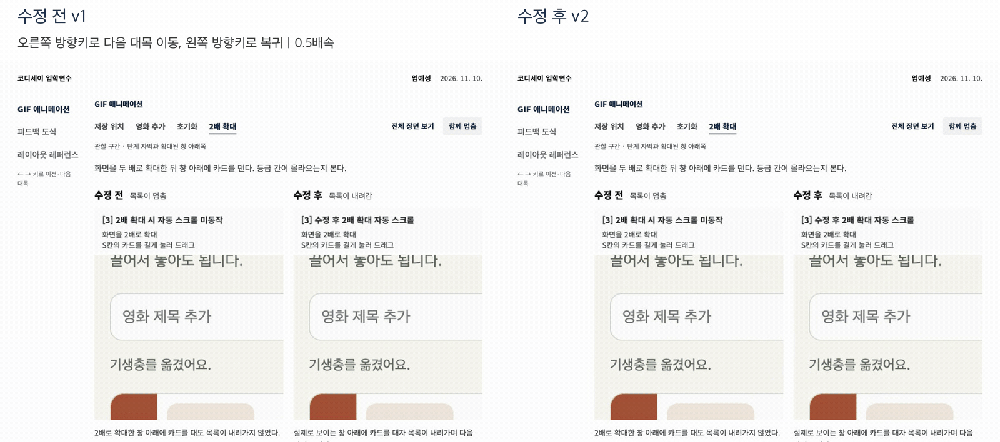
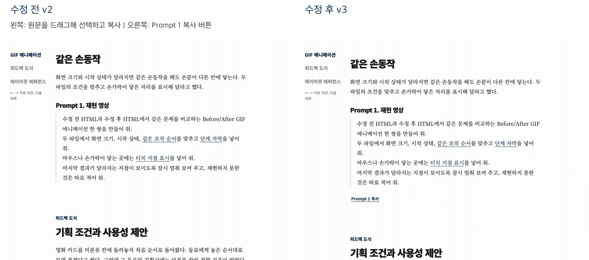
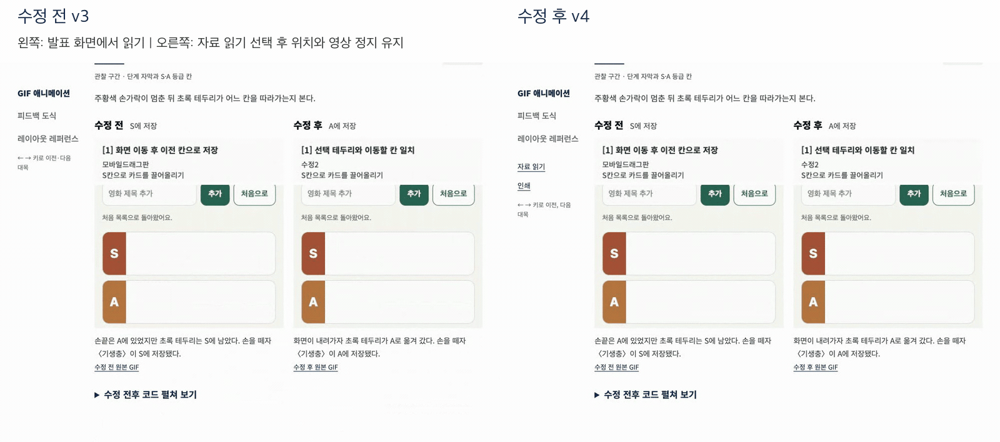
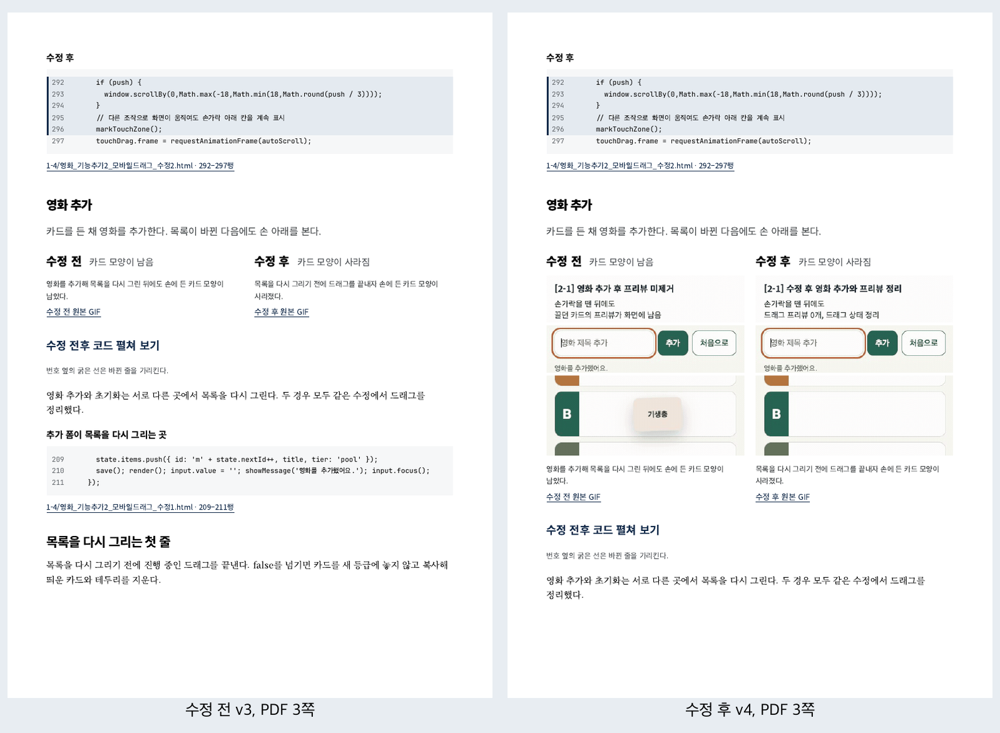

# 제작검증기록: Codyssey Mission AI 활용법

## 기준본과 선택

2-2의 선택 파일은 Astra 최초본 [미션AI활용법_v1.html](../2-2/미션AI활용법_v1.html)이다. 이 결과를 바탕으로 화면 크기와 이동 순서, 제목과 원고를 다듬어 11월 10일 [미션톤 발표본](../2-2/missionthon-ai-tips-yesunglim.html)을 만들었다. 2-3은 개인 수정이 담긴 이 발표본에서 출발해 전환, 요청문 복사, 읽기와 인쇄를 보완한 `v4`다.

11월 12일에는 실제 발표본을 2-3의 수정 기준으로 정했고, 11월 13일에는 Astra 최초본을 2-2의 선택 파일로 정했다. 아래 기록은 이 제작 순서와 각 파일에 수행한 검사를 따른다.

## 두 AI 비교

- AI A: OpenAI Codex, GPT-6 Astra, `xhigh`
- AI B: Claude Code, Claude Opus 5.5, `extra`
- 동일한 기획서와 함께 전달한 요청: 같은 `공통입력.zip`, [최초 공통 기획서](../2-2/참고/최초_공통기획서.md), [최초 공통 요청 전문](../2-2/참고/최초_공통요청.txt)을 두 새 세션에 전달했다. 요청은 네 사례의 전후 녹화와 코드, 원본 도식, 레퍼런스, 여섯 요청문을 단일 HTML로 만드는 내용이다.

다음은 2-2 기록에 있는 11월 13일의 재검사 결과다. Codex가 Chrome 157.0.8103.51의 1440×900 화면에서 두 최초 HTML을 비교했다.

| 테스트 내용 | AI A: Astra | AI B: Claude |
| --- | --- | --- |
| 첫 화면에서 전후 결과 찾기 | 두 녹화 위에 ‘S에 저장’, ‘A에 저장’을 붙이고 설명을 아래에 배치했다. | 두 녹화 옆에 조작과 결과 설명을 배치했다. |
| 네 사례를 고르고 함께 멈춤 실행 | 사례에 맞게 전후 영상과 코드가 바뀌고 정지 프레임을 유지했다. | 같은 조작에서 전후 영상과 코드가 바뀌고 정지 프레임을 유지했다. |
| 목차에서 첫 요청을 찾아 복사 | ‘요청문 모음’에서 ‘이 문구 복사’를 눌렀다. 실제 clipboard의 205자가 원문과 일치했다. | 같은 목차에서 ‘요청 1 복사’를 눌렀다. 실제 clipboard의 205자가 원문과 일치했다. |

선택한 결과물은 Astra 최초본이다. 두 결과의 저장 위치를 바로 비교하는 배치가 발표 목적에 맞았다. 지인이 좋게 본 Claude의 부드러운 전환은 GPT 계열 발표본을 개선하는 데 반영했다. [2-2의 전체 비교와 보너스 검사](../2-2/제작검증기록.md)에 Claude, Astra 순서의 화면과 좁은 화면, 연결 차단, Safari 비교를 함께 정리했다.

## 테스트 기록

2026년 11월 12일, macOS의 Chrome 157.0.8103.51에서 2-2의 개인 수정 발표본 `missionthon-ai-tips-yesunglim.html`을 `file://`로 다시 열었다. 관찰과 측정은 Codex가 수행했다. 이 세 테스트를 2-3 수정 전의 상태로 기록했다.

| 번호 | 테스트 내용 | 예상 결과 | 실제 결과 |
| --- | --- | --- | --- |
| 1 | 네 탭을 고르고 함께 멈춤, 전체 장면, 코드 펼치기를 실행했다. | 같은 사례의 영상과 코드가 보이고 정지가 유지된다. | 네 사례가 각각 열렸다. 정지 후 프레임 값이 유지됐다. 전체 영상은 양쪽 모두 높이 960px였다. 네 사례의 코드가 열렸다. |
| 2 | 도식, 일곱 레퍼런스와 Prompt 1~6을 찾고 요청문을 가져갈 방법을 확인했다. | 자료를 읽고 필요한 요청을 이용할 수 있다. | 일곱 이미지와 여섯 요청문이 있었다. 복사 버튼은 없어 원문을 직접 선택해야 했다. |
| 3 | 네트워크를 끄고 390×844로 열었다. | 본문과 내장 자료가 화면 너비 안에 표시된다. | 문서의 가로 스크롤 너비는 390px였다. 녹화와 일곱 이미지가 표시됐다. JavaScript 실행 오류는 없었다. |

## 수정 기록

작성자는 발표본, 개인 수정, 지인의 의견과 나머지 2-3 요구사항을 반영해 최종으로 정리해 달라고 요청했다. 아래에는 이 요청을 작업별로 정리했다. 각 작업 뒤에 전체 HTML을 별도 버전으로 저장하고, 수정한 파일을 로컬 Git에도 순서대로 남겼다.

### 수정 기록 1. 페이지 전환

**발견한 문제**

지인에게 GPT와 Claude 파일을 제공해 각각 열어 보도록 했다. 전반적인 만듦새는 GPT가 좋지만 페이지 전환은 Claude가 좋다는 의견을 받았다. 두 파일의 이동 코드를 대조하니 발표본은 즉시 이동하고 Claude 원본은 부드럽게 스크롤했다. 기대한 것은 발표본의 내용을 보존하면서 전환의 움직임을 보완하는 것이었다.

**AI에게 전달한 요청: 작업별 정리**

GPT 발표본의 개인 수정과 방향키 순서를 유지하고, Claude 버전에서 좋게 본 부드러운 전환을 반영한다. 빠른 연속 입력과 움직임 줄이기에서도 같은 이동 순서를 유지한다.

**변경 버전**

`v2`, 로컬 커밋 `437772d`. 전체 파일은 `미션AI활용법_v2.html`로도 보존했다.

**수정 후 테스트 결과**

저장 위치에서 `→` 네 번은 영화 추가, 초기화, 2배 확대, 같은 손동작 순서였고 `←` 네 번은 역순이었다. 전환 도중 연속 입력을 넣어도 마지막 목표에 도착했다. 이동 중간과 끝의 스크롤 위치가 달라 실제로 움직이는 것을 확인했다. 움직임 줄이기에서는 바로 이동했고 녹화는 0번 프레임에서 정지했다. 기존의 네 탭과 코드 열기도 다시 확인했다.

**수정 이유**

발표자가 자료가 바뀌는 순간을 보고 이전 위치와 다음 위치를 파악할 수 있어야 한다.

**실행 증거**

같은 오른쪽 방향키와 왼쪽 방향키를 두 판본에서 실행했다. 짧은 전환을 볼 수 있도록 이 GIF는 0.5배속으로 재생한다. 1000×760 화면에서 시작 위치는 0px, 다음 대목은 914px였다. v1은 바로 도착했고, v2의 화면 갱신 기록에는 두 위치 사이의 값이 20회 기록됐다.

[수정 전 화면](검증/수정1_전.png), [수정 후 화면](검증/수정1_후.png), [전환 위치 측정값](검증/실행결과.json)

### 수정 기록 2. 요청문 복사

**발견한 문제**

발표본에서 여섯 요청문을 가져가려면 긴 문장을 직접 선택해야 했다. 동료가 복사 버튼을 눌러 요청을 가져갈 수 있으리라 기대했으나 실제 화면은 원문 선택 방식이었다.

**AI에게 전달한 요청: 작업별 정리**

요청문 원문과 줄바꿈을 유지한 채 각 요청의 복사와 전체 복사를 추가한다. clipboard 쓰기가 거부되면 원문을 선택한 창과 수동 복사 방법을 제공한다.

**변경 버전**

`v3`, 로컬 커밋 `7d03fc4`. 전체 파일은 `미션AI활용법_v3.html`로도 보존했다.

**수정 후 테스트 결과**

실제 clipboard에서 읽은 여섯 문구가 발표본의 원문과 일치했다. 길이는 각각 205, 183, 235, 226, 383, 196자였다. 제목까지 포함한 전체 복사는 1,543자였다. clipboard 쓰기를 거부하는 조건을 별도로 주자 첫 요청의 205자가 모두 선택된 창이 열렸다. `Esc`로 닫으면 원래 복사 버튼으로 돌아왔다. 팝업 안에서 방향키를 눌렀을 때 발표 위치가 유지됐다. 여섯 요청문 모두 발표본 원문과 일치했다.

**수정 이유**

동료가 긴 요청문 전체를 가져갈 수 있어야 한다. 권한 때문에 복사가 실패했을 때도 다음에 할 행동이 보여야 한다.

**실행 증거**

v2에서는 마우스로 첫 요청 전체를 선택한 뒤 복사 단축키를 눌렀다. v3에서는 ‘Prompt 1 복사’를 한 번 눌렀다. 실제 clipboard에서 읽은 두 결과 모두 원문 205자와 일치했다.

[수정 전 선택 화면](검증/수정2_전.png), [수정 후 복사 완료 화면](검증/수정2_후.png), [권한 거부 시 수동 복사 창](검증/수정2_복사권한거부.png)

권한 거부 검사는 `clipboard.writeText`가 `NotAllowedError`를 반환하도록 조건을 주어 실행했다. 열린 창에서 205자 전체가 선택됐고, `Esc` 뒤 원래 버튼으로 초점이 돌아왔다.

### 수정 기록 3. 읽기와 인쇄

**발견한 문제**

발표본은 발표용 방향키 이동을 기본으로 제공했고, 인쇄에서는 선택한 탭의 영상 영역만 표시했다. 기대한 것은 발표 뒤 현재 위치에서 자료를 읽고, 인쇄에서도 모든 사례의 결과를 비교할 수 있는 상태였다.

**AI에게 전달한 요청: 작업별 정리**

현재 위치에서 영상을 멈추고 읽을 수 있게 한다. Q&A에서 자료와 표지로 돌아갈 수 있게 하고, 인쇄에서는 네 사례의 전후 결과와 레퍼런스가 모두 보이게 한다.

**변경 버전**

`v4`, 로컬 커밋 `f64367c`. 최종 HTML. 전체 파일을 `미션AI활용법_v4.html`로도 보존했다.

**수정 후 테스트 결과**

읽기 전환 전후 스크롤 위치가 같고 영상의 정지 프레임도 유지됐다. Q&A의 버튼을 키보드로 실행해 자료로 돌아갔다. 인쇄에는 네 사례의 실제 57번 프레임 여덟 개와 여섯 요청문을 넣었다. 첫 렌더에서 OpenAI 기준 캡처만 빠진 것을 발견해 print CSS를 고쳤고, 일곱 레퍼런스가 모두 인쇄되는지 다시 확인했다. 최종 인쇄 PDF는 모든 페이지를 렌더해 살폈다. 기존 도식과 영상 자료, 발표 문장은 보존했다.

**수정 이유**

동료가 발표 뒤 혼자 필요한 자료를 찾아 읽고 가져갈 수 있어야 한다. 인쇄물에서도 네 사례 전체를 비교할 수 있어야 한다.

**실행 증거**

본문을 140px 내린 위치에서 확인했다. v3에서는 녹화 프레임이 계속 바뀌었다. v4에서 ‘자료 읽기’를 선택하자 같은 스크롤 위치와 정지 프레임이 유지됐다.

[수정 전 화면](검증/수정3_전.png), [수정 후 읽기 화면](검증/수정3_후.png)

[수정 전 인쇄 PDF, 14쪽](검증/수정3_인쇄_전.pdf)와 [수정 후 인쇄 PDF, 16쪽](검증/수정3_인쇄_후.pdf)를 첨부했다. 두 PDF의 3쪽을 비교하면 영화 추가 사례의 전후 정지 화면이 추가된 것을 볼 수 있다. 수정 전에는 선택한 탭의 영상과 레퍼런스 여섯 개가 인쇄됐고, 수정 후에는 네 사례의 정지 화면 여덟 개와 레퍼런스 일곱 개가 인쇄됐다.

[수정 전 PDF 전체 페이지](검증/수정3_인쇄_전_전체페이지.png), [수정 후 PDF 전체 페이지](검증/수정3_인쇄_후_전체페이지.png)

## 사용자 테스트

| 항목 | 기록 |
| --- | --- |
| 테스트 참여자와 요청한 작업 | 지인 한 명에게 Claude 버전과 GPT 버전을 각각 열어 보도록 파일을 제공했다. |
| 사용자의 행동과 질문 | 두 파일을 열어 보고 비교 의견을 줬다. 세부 키 입력 순서와 질문, 사용법 안내 여부는 미기록이다. |
| 받은 피드백 | GPT 버전의 전반적인 만듦새가 좋지만 페이지를 넘기는 인터랙션은 Claude가 좋다는 의견이었다. 11월 12일 작성자가 전달했다. |
| 반영 내용과 결과 | GPT 발표본의 내용과 개인 수정을 유지하고 전환을 부드럽게 고쳤다. 수정 1의 왕복 이동, 연속 입력, 움직임 줄이기 검사를 통과했다. |

## 실행 증거와 재현 방법

평가 항목 #2의 실행 증거 보완을 위해 2026년 11월 13일 Chrome 157.0.8103.51에서 각 수정 전후 HTML을 다시 실행했다. 화면 크기는 1000×760이며 파일을 직접 열었다. 실행과 측정은 Codex가 수행했다.

- [브라우저 콘솔 로그](검증/브라우저콘솔.log): 9개 상황의 실행 시각과 조작 순서, console 이벤트, JavaScript 실행 오류와 요청 실패를 기록했다. 세 이벤트 수는 각 상황에서 모두 0이었다.
- [실행 결과와 파일 해시](검증/실행결과.json): 판본별 Git 위치와 SHA-256, 전환 위치, 복사 원문 일치, 읽기 위치와 프레임, 인쇄 구성 수를 확인할 수 있다.
- [재현 안내](검증/재현안내.md): 비교할 판본, 손으로 확인하는 절차와 자동 재현 명령을 정리했다. [재현 검사 코드](검증/재현검사.mjs)와 [GIF 및 PDF 스냅샷 변환 코드](검증/증거변환.py)를 함께 첨부했다.

## 최종 검증

2026-11-12.
Chrome 157.0.8103.51에서 최종 `v4`를 실행했다. 아래 결과는 Codex가 실제 브라우저를 조작하고 화면을 확인한 범위다.

| 검사 | 결과 |
| --- | --- |
| 방향키 왕복과 전환 도중 연속 입력 | 통과 |
| 움직임 줄이기 | 애니메이션 없이 이동, 영상 정지 상태 유지 |
| 요청문 보존과 실제 clipboard | 개별 여섯 문구 및 전체 문구 일치 |
| clipboard 거부 | 원문 선택과 `Esc` 복귀 확인 |
| 일곱 레퍼런스 | 정방향과 역방향 순서 일치 |
| 자료 읽기와 Q&A 복귀 | 현재 위치 유지, 자료와 표지로 복귀 |
| 인쇄 | 전후 정지 화면 여덟 개, 레퍼런스 일곱 개, 요청문 여섯 개 표시 |
| 네트워크 차단 | 단일 로컬 HTML의 내장 자료 표시 |
| JavaScript 실행 오류 | 검사 중 0건 |

| 화면 크기 | 문서 가로 너비 | 도식 | 도식 내부 스크롤 |
| --- | --- | --- | --- |
| 1440×900 | 1440px | 가시 영역 안에 전체 표시 | 없음 |
| 1280×720 | 1280px | 가시 영역 안에 전체 표시 | 없음 |
| 390×844 | 390px | 고정 목차 아래에 전체 표시 | 없음 |
| 844×390 | 844px | 가시 영역 안에 전체 표시 | 없음 |
| 720×450 | 720px | 고정 목차 아래에 전체 표시 | 없음 |

720×450은 브라우저 창의 작은 가시 영역을 지정한 검사다.

11월 13일 제출 전 점검에서는 원본과 바이트가 같은 HTML을 로컬 미리보기로 열었다. Chrome 157.0.8103.51에서 방향키 네 번의 순서를 다시 확인했고, 첫 요청의 실제 clipboard 205자가 화면 원문과 일치했다. 읽기 전환 전후 스크롤 위치는 모두 1,124px였다. 인쇄 구성에는 정지 화면 여덟 개, 레퍼런스 일곱 개, 요청문 여섯 개가 표시됐다. 기획서와 제작검증기록은 1280px와 390px 화면에서 열어 표와 본문을 확인했다.

## 원문과 실제 파일의 차이

이전 기획과 제작 요청에는 표지를 없애거나 별도 독립 검사 절을 넣는 구성이 있었다. 실제 발표에서는 표지와 소개, Q&A를 채택하고 일부 절을 뺐다. 이에 미션톤 발표본을 기준으로 삼고 기획서를 실제 파일에 맞췄다.

과제는 선택 근거와 테스트 결과를 본인이 판단하고 관찰하도록 요구하므로, 작성자의 최종 선택과 지인에게 받은 의견은 직접 전달받은 내용으로 적었고, Codex가 수행한 재검증은 날짜와 환경, 관찰 주체를 밝혀 기재하였다.

## 최종 산출물

- [미션AI활용법_최종.html](미션AI활용법_최종.html)
- [기획서.md](기획서.md)
- [제작검증기록.md](제작검증기록.md)
